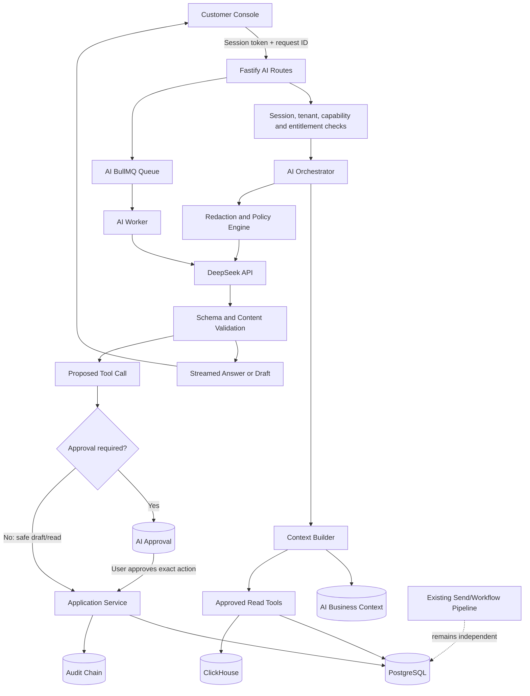

# Valasys Mail AI Architecture and Implementation Plan

> Current plan: [decision summary and delivery gates](AI_DELIVERY_DECISION_SUMMARY.md) and [Ollama engineering specification](AI_OLLAMA_HARNESS_REVIEW_AND_ACTION_PLAN.md), revised 20 October 2026. The document below is an earlier proposal. Its customer-UI and missing contacts/audiences/campaigns assessment predates the current implementation, and its direct-DeepSeek inference recommendation is superseded by the hosted-Ollama requirement.

## Executive summary

Valasys Mail already has a capable multi-tenant email-delivery platform: a Fastify API, PostgreSQL with fail-closed row-level security, Redis and BullMQ workers, template rendering, message and engagement events, ClickHouse analytics, versioned workflow automation, SMTP ingress and egress, API-key and human-session authentication, capability-based authorization, audit integrity, privacy controls, and production deployment assets.

The visible **Valasys AI** experience in the customer dashboard is not connected to those systems. It is currently a scripted design prototype. It recognizes keywords in the browser, uses timers to simulate work, returns hard-coded answers, and updates local component state. It does not call an LLM, persist a conversation, query tenant data, create real campaigns, or execute backend tools.

The recommended solution is a controlled AI application layer that uses DeepSeek from the backend only. The first release should be an AI writing and content-analysis assistant. Read-only analytics should follow. Campaign, segment, and workflow creation should be introduced only after the missing marketing-domain foundation is implemented. Sending, scheduling, modifying live automations, and other consequential actions must remain approval-gated.

The practical delivery targets are:

| Target | Expected scope | Estimated delivery with three engineers |
| --- | --- | ---: |
| AI writing MVP | Subjects, preheaders, draft, rewrite, content analysis, business context | 6–9 weeks |
| Analytics copilot | Grounded questions over aggregated delivery data | Additional 2–3 weeks |
| Campaign copilot | Profiles, segments, campaigns, audience preview, draft generation | 14–20 weeks total |
| Broad account agent | Safe tool orchestration, approvals, workflow drafts, recommendations | 18–26 weeks total |

The central architectural principle is:

> DeepSeek may propose and explain. Valasys services validate, authorize, persist, approve, and execute.

---

## 1. Goals and non-goals

### Goals

1. Add AI-assisted email writing comparable to the useful parts of Apollo and Customer.io.
2. Ground output in tenant-owned business context and approved platform data.
3. Preserve tenant isolation, role permissions, auditability, suppression rules, and delivery safeguards.
4. Keep the DeepSeek API key and provider integration entirely server-side.
5. Support streaming responses without coupling mail delivery to LLM availability.
6. Produce structured, validated drafts that fit the existing template and workflow systems.
7. Add measurable quality, cost, safety, latency, and user-feedback controls.
8. Provide an extensible provider boundary so DeepSeek can be upgraded or replaced without rewriting product logic.

### Non-goals for the first release

- Autonomous sending.
- Arbitrary SQL generated by the model.
- Unrestricted access to recipient personal data.
- Web browsing or prospect enrichment.
- Automatic modification of active workflows, domains, IP pools, suppressions, billing, or account security.
- Training or fine-tuning on customer content.
- Adding a vector database before a validated retrieval use case exists.
- Claiming that an LLM can guarantee inbox placement or regulatory compliance.

---

## 2. Repository assessment

### 2.1 Existing platform architecture

The repository is a TypeScript monorepo containing these relevant services:

| Package/service | Current responsibility | AI relevance |
| --- | --- | --- |
| `packages/api` | Fastify API and authentication planes | Host synchronous AI APIs and authorization |
| `packages/shared` | Database schema, services, security, inference seam | Host reusable AI contracts, policies, validation, and provider interface |
| `packages/worker` | BullMQ send, event, webhook, workflow, and scheduled work | Pattern for a separate AI generation worker |
| `packages/tracker` | Open, click, and unsubscribe collection | Source of aggregated engagement data |
| `packages/admin-console` | Real React/Vite operator console | Pattern for a production browser application |
| `packages/customer-ui` | `.dc.html` customer experience prototype | UX source, but not currently a production application |
| `infra/migrations` | PostgreSQL schema and RLS | Add AI and marketing-domain tables here |
| `infra/helm` / Compose | Deployment | Add AI configuration, secrets, worker, and alerts |

The main delivery path is deliberately reliable and asynchronous:

```text
REST / SMTP / SendGrid compatibility / SDK
                    |
                    v
               Fastify API
                    |
          PostgreSQL + send outbox
                    |
                    v
             Redis / BullMQ
                    |
                    v
         send worker -> SES/Haraka -> recipient MX
                    |
                    +-> delivery events -> webhooks / ClickHouse
```

AI must remain outside this hot path. A DeepSeek outage must not delay or break accepted email delivery.

### 2.2 Existing AI-related implementation

There are two separate starting points:

1. `packages/shared/src/inference.ts` defines an `InferenceProvider` abstraction for support ticket triage and suggested replies. Its default implementation is a local deterministic heuristic. This is a useful provider pattern, but its interface is too narrow for product-wide AI.
2. `packages/customer-ui/Valasys Mail Dashboard.dc.html` contains the visible AI dock. Its `planFor()` method matches phrases such as `draft`, `analytics`, `domain`, and `usage`; it then returns fixed steps and fixed text. Timers make the steps look asynchronous. This code should be treated as UX prototyping, not backend architecture.

### 2.3 Existing strengths to reuse

- Templates already enforce body-size limits and validate Handlebars syntax.
- Workflows already separate editable drafts from immutable published versions.
- Workflow simulation already supports side-effect-free preview.
- The platform already has an outbox philosophy for durable execution.
- API keys and human users already occupy separate authentication planes.
- Human roles map to capabilities rather than a fragile numeric hierarchy.
- Tenant tables use PostgreSQL row-level security.
- Audit records already capture security-relevant mutations.
- Content restrictions, suppression, consent, retention, and privacy deletion already exist.
- Tests already use real PostgreSQL and Redis for service-level end-to-end validation.

### 2.4 Blocking gaps

The current backend has no production tables or APIs for:

- Profiles/contacts.
- Custom profile attributes.
- Profile behavior events independent of mail delivery events.
- Segments/audiences and segment condition definitions.
- Campaigns/broadcasts.
- Campaign versions and content variants.
- Audience snapshots and campaign enrollment.
- Per-recipient AI personalization jobs.
- AI settings and business context.
- AI conversations, runs, tool calls, approvals, usage, and feedback.

The customer UI is also not included in the root workspace build. Before a real AI experience can ship, it must become a deployable customer-console application with authentication, routing, a typed API client, error handling, and browser tests.

### 2.5 Product implication

The current platform can support a high-quality AI writing assistant immediately after adding the AI service. It cannot truthfully support the complete demonstration prompt—“find dormant contacts, create a segment, draft a campaign, and schedule it”—until profiles, segments, campaigns, and audience snapshots are real backend concepts.

---

## 3. Competitive product pattern

### 3.1 Apollo pattern

Apollo combines several layers:

- Account-level product, service, value proposition, tone, and messaging context.
- Full-email, subject-line, opener, P.S., and snippet generation.
- Rewriting selected text with actions such as shorten and simplify.
- Prospect/account research for per-recipient personalization.
- Sequence generation.
- Natural-language assistant actions over account resources.
- Preview and insertion before sending.

The transferable lesson is not “add a chat box.” It is to provide structured business context, focused generation actions inside the editor, account-aware tools, and a review step before content becomes live.

### 3.2 Customer.io pattern

Customer.io extends AI across content, segments, automations, analytics, and recurring routines. Its most important architectural patterns are:

- The agent inherits the current user’s permissions.
- AI can be disabled at account level.
- Live-data editing is disabled by default.
- Draft creation is distinguished from live-resource modification.
- Consequential actions use approval flows.
- Sensitive data access is controlled separately.
- Business context and compliance instructions influence content generation.

### 3.3 Recommended Valasys positioning

Valasys should first emulate Customer.io’s messaging and operational assistant rather than Apollo’s prospect-research product. The repository is an email infrastructure and lifecycle-automation platform, not a B2B data-enrichment network. Apollo-style web research would require separate data licenses, enrichment providers, provenance, legal review, and a new data product.

---

## 4. Product capability roadmap

### Tier 1 — Editor assistance

| Capability | Inputs | Output | Execution policy |
| --- | --- | --- | --- |
| Subject generation | Final body, business context, tone | 3–5 subjects with rationale | User inserts one |
| Preheader generation | Subject and body | 3 options | User inserts one |
| Full draft | Objective, audience description, offer, CTA, tone | Subject, preheader, HTML, text | Draft only |
| Rewrite selection | Selected text and instruction | Replacement text | User accepts/rejects |
| Tone change | Selected text, tone | Replacement text | User accepts/rejects |
| Summarize/shorten | Selected text, target length | Replacement text | User accepts/rejects |
| Plain-text conversion | HTML | Text alternative | User accepts/rejects |
| Content analysis | Subject, preheader, body | Structured findings | Advisory only |
| Translation | Source content and locale | Translated draft | Human review required |

### Tier 2 — Grounded analytics

- Compare date ranges.
- Explain bounce, complaint, open, click, and delivery changes.
- Break down results by template, domain, and tag.
- Distinguish human and machine opens where available.
- Explain quota and usage status.
- Identify correlations and anomalies while labeling them as correlations.
- Link each statement to the metric/tool result used.

### Tier 3 — Draft resource creation

- Generate a template draft.
- Generate a workflow draft matching the validated workflow schema.
- Generate a segment condition tree.
- Generate a campaign draft with variants.
- Simulate a workflow or estimate a segment before saving.

### Tier 4 — Approval-gated actions

- Save a draft.
- Modify an unused draft.
- Publish a workflow.
- Activate or pause an automation.
- Schedule a campaign.
- Trigger a bounded test audience.
- Apply a recommended deliverability configuration.

Sending must always use the normal platform send path so suppression, sender verification, quota, content classification, tracking, retention, and audit rules remain authoritative.

---

## 5. Target system architecture



### Component responsibilities

#### Customer console

- Capture user intent and editor context.
- Stream progress and output.
- Show sources/tool results.
- Render diffs instead of silently replacing content.
- Present action previews and confirmation controls.
- Never receive the DeepSeek API key.

#### AI API routes

- Authenticate the human session.
- Resolve active tenant and role.
- Check AI enablement, plan entitlement, capability, rate, and budget.
- Validate bounded request schemas.
- Create an `ai_run` before provider invocation.
- Stream normalized events to the UI.
- Never directly implement mail-domain mutations.

#### AI orchestrator

- Select an operation-specific prompt.
- Gather minimum required context.
- Expose an allowlisted tool set.
- Run a bounded tool loop.
- Reject unknown or repeated tool calls.
- Produce a final response or proposed action.

#### Policy engine

- Remove secrets and disallowed fields.
- Enforce tenant AI settings.
- Apply regulated-mode restrictions.
- Attach compliance and business-context instructions.
- Apply maximum lengths and token budgets.
- Treat templates, profile fields, events, and tool results as untrusted data.

#### Application services

- Perform real reads and writes.
- Recheck tenant, permissions, resource status, and optimistic version.
- Use parameterized queries and existing validators.
- Remain usable independently of AI.

#### AI worker

- Run bulk or long-running generation.
- Apply per-tenant concurrency and budget limits.
- Persist progress and allow cancellation.
- Stay isolated from delivery queues and workers.

---

## 6. Package and code organization

Recommended additions:

```text
packages/
  ai/
    src/
      provider.ts
      deepseek-provider.ts
      mock-provider.ts
      orchestrator.ts
      context-builder.ts
      redaction.ts
      usage.ts
      approvals.ts
      events.ts
      prompts/
        registry.ts
        email-draft.v1.ts
        subject-lines.v1.ts
        rewrite.v1.ts
        content-analysis.v1.ts
        analytics-answer.v1.ts
        workflow-draft.v1.ts
      tools/
        registry.ts
        analytics-tools.ts
        template-tools.ts
        workflow-tools.ts
        campaign-tools.ts
      schemas/
        email.ts
        analytics.ts
        tools.ts
  ai-worker/
    src/
      bootstrap.ts
      generation-worker.ts
  customer-console/
    src/
      api/
      auth/
      ai/
      editor/
      analytics/
      campaigns/
      workflows/
```

Do not overload the current support-only `InferenceProvider` with dozens of unrelated methods. Replace or wrap it with a generic provider interface while retaining compatibility for support triage.

Suggested provider contract:

```ts
export interface AIProvider {
  readonly name: string;

  generateStructured<T>(
    request: StructuredGenerationRequest<T>
  ): Promise<GenerationResult<T>>;

  streamText(
    request: TextGenerationRequest
  ): AsyncIterable<AIStreamEvent>;

  completeWithTools(
    request: ToolGenerationRequest
  ): Promise<ToolGenerationResult>;
}
```

Product code should consume normalized provider results. DeepSeek request IDs, finish reasons, token details, and errors should be translated at the adapter boundary.

---

## 7. DeepSeek design

### Configuration

```env
AI_ENABLED=false
AI_PROVIDER=deepseek
DEEPSEEK_API_KEY=
DEEPSEEK_BASE_URL=https://api.deepseek.com
DEEPSEEK_DEFAULT_MODEL=deepseek-v4-flash
DEEPSEEK_ANALYSIS_MODEL=deepseek-v4-pro
AI_REQUEST_TIMEOUT_MS=30000
AI_TOOL_LOOP_MAX_STEPS=6
AI_MAX_INPUT_TOKENS=12000
AI_MAX_OUTPUT_TOKENS=3000
AI_TENANT_CONCURRENCY=3
AI_DAILY_TENANT_BUDGET_USD=10
AI_STORE_CONVERSATION_CONTENT=false
AI_CONTENT_RETENTION_DAYS=30
```

The model name must be configuration, not a constant. DeepSeek changes aliases and model versions over time.

### Model routing

| Work type | Recommended model | Thinking |
| --- | --- | --- |
| Subjects, preheaders, rewrite | `deepseek-v4-flash` | Disabled |
| Full email draft | `deepseek-v4-flash` | Disabled |
| Translation | `deepseek-v4-flash` | Disabled |
| Content analysis | Flash first; evaluate Pro | Disabled by default |
| Analytics explanation | Flash; Pro for complex multi-step comparison | Configurable |
| Workflow/segment planning | `deepseek-v4-pro` | Enabled only when quality gain is proven |
| Tool selection | Flash | Disabled for latency and predictability |

### Transport

- Call `https://api.deepseek.com` only from backend services.
- Use SSE for interactive streaming.
- Apply connection and total-request timeouts.
- Retry only safe failures: connection errors, 429, and selected 5xx responses.
- Use exponential backoff with jitter and a low retry ceiling.
- Add a circuit breaker to prevent request storms during provider degradation.
- Return a stable `ai_provider_unavailable` error while preserving drafts already in the editor.
- Record provider-reported token usage as the billing source of truth.

### Structured output

Use JSON output for subject options, email drafts, findings, plans, and proposed actions. Every response must pass local Zod validation. JSON mode is not authorization and does not eliminate hallucinated values.

Example email-draft result:

```json
{
  "subject_options": [
    { "text": "Your September product update", "reason": "Clear and specific" }
  ],
  "preheader": "See what changed and what to try next.",
  "html": "<h1>...</h1>",
  "text": "...",
  "variables_used": ["first_name"],
  "claims_to_verify": [],
  "warnings": []
}
```

Validation pipeline:

1. Parse JSON.
2. Validate schema and size limits.
3. Verify referenced variables against the approved variable catalog.
4. Compile all Handlebars fields.
5. Confirm protected variables were not removed or renamed during rewrite.
6. Sanitize generated HTML.
7. Validate URLs and block unsafe schemes.
8. Run existing prohibited-data and content checks.
9. Return a draft and warnings.
10. Validate again when the user saves.

---

## 8. Context and grounding

### Business Context Center

Create a tenant-level, versioned context resource containing:

```text
Company
  name
  description
  industry
  primary website

Products/services
  name
  description
  audience
  customer pains
  value propositions
  differentiators
  approved evidence/claims

Voice
  tone
  formality
  preferred words
  prohibited words
  example messages

Compliance
  required statements
  prohibited claims
  jurisdiction notes
  custom compliance prompt

Defaults
  locale
  CTA style
  physical address
  sender identity
  unsubscribe group
```

Context must be versioned. Each AI run records the exact context version used so output can be reproduced and audited.

### Retrieval strategy

For MVP, use structured PostgreSQL data and deterministic retrieval. Do not introduce embeddings merely because the feature is labeled AI.

Later knowledge-library support can use:

1. Object storage for uploaded source files.
2. Parsed, tenant-scoped chunks.
3. A documented embedding provider.
4. PostgreSQL `pgvector` or a separate vector store.
5. Per-document access rules and retention.
6. Citations from generated text to retrieved chunks.

No retrieved text may become system-level instruction. Customer documents and message bodies are untrusted content and must be delimited as data.

---

## 9. Data model

### 9.1 AI tables

#### `ai_settings`

```text
customer_id PK/FK
enabled
allow_read_tools
allow_draft_tools
allow_live_edits
allow_sensitive_data
default_model
daily_budget_usd
monthly_budget_usd
compliance_prompt
content_retention_days
created_at
updated_at
```

#### `ai_business_contexts`

```text
id
customer_id
version
status: draft | active | archived
context JSONB
created_by_user_id
created_at
activated_at
UNIQUE(customer_id, version)
```

#### `ai_conversations` and `ai_messages`

```text
ai_conversations:
  id, customer_id, user_id, title, surface, resource_type,
  resource_id, created_at, updated_at, expires_at

ai_messages:
  id, conversation_id, customer_id, role, content_ciphertext,
  content_hash, metadata, created_at
```

If content storage is disabled, persist only operational metadata and hashes.

#### `ai_runs`

```text
id
customer_id
user_id
conversation_id nullable
operation
provider
model
prompt_version
business_context_id
status: queued | running | completed | failed | canceled
input_tokens
output_tokens
cached_input_tokens
estimated_cost_usd
latency_ms
provider_request_id
request_hash
response_hash
error_code
created_at
completed_at
```

#### `ai_tool_calls`

```text
id
ai_run_id
customer_id
tool_name
action_class: read | draft | live_write | send | destructive
arguments_redacted JSONB
arguments_hash
resource_type
resource_id
resource_version
status: proposed | approval_required | approved | denied | executing | completed | failed
result_redacted JSONB
created_at
executed_at
```

#### `ai_approvals`

```text
id
customer_id
tool_call_id
requested_by_user_id
approved_by_user_id nullable
decision: pending | approved | denied | expired
arguments_hash
expires_at
decided_at
```

#### `ai_usage_daily` and `ai_feedback`

Usage supports quotas, plan entitlements, cost controls, and billing. Feedback captures accept, reject, regenerate, edit distance, thumbs up/down, and optional reason without silently treating customer content as training data.

Every AI table must use fail-closed tenant RLS and be included in retention, privacy export, erasure, backup, audit, and data-inventory documentation.

### 9.2 Marketing-domain tables

Full campaign assistance requires:

```text
profiles
profile_attributes
profile_events
segments
segment_versions
campaigns
campaign_versions
campaign_variants
campaign_audience_snapshots
campaign_recipients
```

Segments should store a validated expression AST, not SQL. Example:

```json
{
  "type": "and",
  "conditions": [
    {
      "field": "last_human_open_at",
      "operator": "before",
      "value": "now-30d"
    },
    {
      "field": "suppressed",
      "operator": "equals",
      "value": false
    }
  ]
}
```

The server validates the AST, compiles parameterized SQL, applies tenant scope, returns an estimated count/sample, and lets the user inspect the logic before saving.

Campaigns require immutable send snapshots. Editing a template after scheduling must not silently change content already approved for a campaign.

---

## 10. Authentication, authorization, and entitlements

### Authentication

AI UI routes must use human session tokens, not customer API keys. Never expose an `mp_live_*` key or the DeepSeek key in browser code.

Introduce a reusable authenticated principal abstraction if shared services must support both API-key callers and human users:

```ts
type Principal =
  | { kind: 'user'; userId: string; customerId: string; role: MembershipRole }
  | { kind: 'api_key'; apiKeyId: string; customerId: string; scopes: string[] };
```

### Capabilities

Add explicit capabilities:

```text
ai:use
ai:configure
ai:read_analytics
ai:create_drafts
ai:approve_live_changes
ai:read_sensitive_data
```

Suggested defaults:

| Role | Use AI | Configure AI | Read analytics | Create drafts | Approve live changes | Sensitive data |
| --- | ---: | ---: | ---: | ---: | ---: | ---: |
| Owner | Yes | Yes | Yes | Yes | Yes | Configurable |
| Admin | Yes | Yes | Yes | Yes | Yes | Configurable |
| Developer | Yes | No | Yes | Yes | No | No |
| Analyst | Yes | No | Yes | No | No | No |
| Billing | No | No | No | No | No | No |

Plan entitlements should be separate from role authorization. A user can have permission to use AI while the tenant’s plan or budget still disallows the operation.

---

## 11. Tool and approval architecture

### Tool classes

| Class | Examples | Default behavior |
| --- | --- | --- |
| Read | Analytics summary, template list, domain status, usage | Automatic when permitted |
| Draft | Create an unsaved email or draft workflow definition | Automatic with visible result |
| Reversible write | Save or update an unused draft | Preview and confirmation |
| Live write | Modify active segment/workflow, pause automation | Admin enablement plus exact approval |
| Send | Schedule campaign, trigger workflow, send test/bulk message | Always exact approval |
| Destructive | Delete resource, bulk suppress/unsuppress | Not available initially |

### Tool rules

1. The LLM selects only from a server-provided registry.
2. Tool arguments use strict local Zod schemas.
3. Unknown fields are rejected.
4. The authenticated tenant is injected by the server, never accepted from the model.
5. The service rechecks capability and current resource status.
6. Reads return bounded and redacted results.
7. Writes call existing application services rather than duplicating domain logic.
8. Every action has a request ID and audit record.
9. Tool loops have maximum steps, duration, and token budgets.
10. Repeated identical calls are deduplicated.

### Approval binding

An approval authorizes exactly one action identified by:

```text
tenant + user + tool + canonical arguments hash + resource version + expiry
```

If the arguments or resource version change, a new approval is required. Approval tokens must be short-lived and single-use. Sending endpoints must retain their existing idempotency guarantees.

---

## 12. API surface

### Generation and analysis

```http
POST /v1/ai/generate/email
POST /v1/ai/generate/subject-lines
POST /v1/ai/generate/preheaders
POST /v1/ai/rewrite
POST /v1/ai/translate
POST /v1/ai/analyze/content
```

Example request:

```json
{
  "objective": "Announce the September analytics release",
  "audience_description": "SaaS product managers",
  "tone": "clear and confident",
  "cta": "View the release notes",
  "locale": "en-US",
  "variables": ["first_name", "company_name"],
  "constraints": {
    "subject_max_chars": 55,
    "body_max_words": 220
  }
}
```

### Assistant and streaming

```http
POST /v1/ai/conversations
POST /v1/ai/conversations/:id/messages
GET  /v1/ai/conversations/:id/events
POST /v1/ai/runs/:id/cancel
```

Normalized SSE events:

```text
run.started
message.delta
tool.proposed
tool.started
tool.completed
approval.required
run.completed
run.failed
```

Do not expose provider-specific streaming events directly to the frontend.

### Approvals

```http
POST /v1/ai/tool-calls/:id/approve
POST /v1/ai/tool-calls/:id/reject
```

Approval response should include the resulting resource and audit identifier. Approval and execution should be transactionally linked where possible.

### Settings and usage

```http
GET   /v1/account/ai/settings
PATCH /v1/account/ai/settings
GET   /v1/account/ai/context
PUT   /v1/account/ai/context
POST  /v1/account/ai/context/activate
GET   /v1/account/ai/usage
GET   /v1/account/ai/audit
```

---

## 13. User experience

### Global AI dock

The existing dock concept is appropriate, but production behavior should show real states:

```text
┌─────────────────────────────────────────────┐
│ Valasys AI                            Close │
├─────────────────────────────────────────────┤
│ You                                         │
│ Why did Gmail delivery fall this week?      │
│                                             │
│ Valasys AI                                  │
│ ✓ Read delivery summary                     │
│ ✓ Compared Gmail with previous 7 days       │
│ ✓ Checked bounce categories                 │
│                                             │
│ Gmail delivery decreased 2.8 percentage     │
│ points. Most of the change came from         │
│ temporary 4xx deferrals on Pool A.           │
│                                             │
│ [Open analytics] [Create remediation draft] │
├─────────────────────────────────────────────┤
│ Ask about this workspace…             Send │
└─────────────────────────────────────────────┘
```

### Editor assistance

```text
Subject
┌──────────────────────────────────────────────┐
│ Your September product update                │
└──────────────────────────────────────────────┘
  Generate alternatives

Body editor                         Ask AI
┌──────────────────────────────────────────────┐
│ Hi {{first_name}},                           │
│ ...                                          │
└──────────────────────────────────────────────┘

Selection toolbar:
[Shorter] [Clearer] [Formal] [Casual] [Custom]

Suggested change:
- We are delighted to announce that...
+ Today we’re releasing...

[Reject] [Regenerate] [Insert]
```

### Approval card

```text
Approval required

Action: Schedule campaign
Campaign: September product update
Audience: Active SaaS users
Recipients: 12,482 at snapshot time
When: 15 Sep 2026, 10:00 Asia/Kolkata
Sender: updates@mail.example.com
Template version: 7

This action will enqueue email to the audience above.

[Deny]                         [Approve schedule]
```

The UI must distinguish generated text, saved drafts, proposed actions, approved actions, and completed actions. “Done” must never appear before the backend confirms completion.

---

## 14. Privacy, security, and compliance

### Provider-data boundary

The DeepSeek API is an external subprocessor boundary. Before production use:

- Complete security and legal vendor review.
- Confirm contractual API data-retention and model-training terms.
- Add DeepSeek to the subprocessor register.
- Update customer privacy disclosures and data-processing documentation.
- Determine international-transfer requirements for every served jurisdiction.
- Document incident notification, deletion assistance, availability, and support commitments.

DeepSeek’s current privacy materials state that personal data may be processed and stored in the People’s Republic of China. Its open-platform terms place responsibility for downstream disclosure, lawful basis, end-user rights, and security controls on the application operator. This makes minimization and regulated-mode restrictions mandatory design concerns, not later refinements.

### Data minimization

Default provider payloads should exclude:

- Recipient email addresses.
- Full recipient lists.
- API keys and session tokens.
- DKIM private keys.
- Webhook secrets.
- Billing-provider payloads.
- Authentication factors.
- Support internal notes unless explicitly required and allowed.
- Regulated message bodies.
- Raw IP addresses and user agents.

Use aggregated analytics whenever identity is unnecessary. Where personalization is later enabled, expose only an allowlisted projection of profile attributes and record which fields were transmitted.

### Regulated modes

Default policy:

| Mode | AI policy |
| --- | --- |
| Normal | Enabled by tenant and plan settings |
| PCI-restricted | Block card data before provider call and on response |
| HIPAA | Disabled until provider contract and independent review explicitly approve use |
| FERPA | Disabled until provider contract and independent review explicitly approve use |
| SEC/FINRA | Disabled unless archive, supervision, retention, and vendor requirements are approved |

### Prompt injection

Treat all customer-controlled text as untrusted:

- Template HTML.
- Contact attributes.
- Event properties.
- URLs and fetched documents.
- Tool outputs.
- Support messages.

Use fixed system instructions, delimiter-based data sections, allowlisted tools, schema validation, output validation, and independent server authorization. Never obey instructions embedded in retrieved tenant data.

### Secrets

- Store `DEEPSEEK_API_KEY` in the existing production secret mechanism.
- Never commit it to `.env`, examples, fixtures, screenshots, logs, or browser bundles.
- Redact authorization headers and provider request bodies from logs/traces.
- Support rotation without rebuild.
- Use separate keys for development, staging, and production.
- Alert on unusual usage or spend.

### Retention and privacy rights

AI data must be added to:

- Data inventory.
- Retention schedules.
- Recipient and account export.
- Erasure and pseudonymization.
- Legal-hold behavior.
- Backup/restore re-deletion procedures.
- Audit and access-review controls.

Do not store chain-of-thought/reasoning content. Prefer hashes and structured operational metadata over raw prompts.

---

## 15. Reliability, performance, and cost

### Isolation

- Interactive generation may run synchronously with streaming.
- Bulk personalization and document processing must use `ai-generation` queues.
- AI queues require separate Redis queue names and worker concurrency.
- AI failure must not affect send, event, webhook, or workflow workers.

### Limits

Apply limits at multiple levels:

```text
Global provider concurrency
Tenant concurrency
User requests per minute
Operation maximum input/output tokens
Daily and monthly tenant budget
Maximum tool-loop steps
Maximum tool-result bytes
Maximum conversation history
Maximum bulk recipients
```

### Caching

Safe cache candidates:

- Stable business context prefixes.
- Content analysis keyed by content hash and prompt version.
- Analytics tool results for a short time window.

Do not share caches across tenants. Invalidate output caches when model, prompt, policy, or business-context versions change.

### Observability

Add metrics such as:

```text
mp_ai_requests_total{operation,model,status}
mp_ai_latency_seconds{operation,model}
mp_ai_tokens_total{direction,model}
mp_ai_estimated_cost_usd_total{model}
mp_ai_tool_calls_total{tool,status}
mp_ai_approvals_total{tool,decision}
mp_ai_schema_failures_total{operation}
mp_ai_policy_blocks_total{reason}
mp_ai_queue_depth
mp_ai_budget_rejections_total
```

Dashboards should show latency percentiles, error rate, token/cost trend, top tenant usage, schema-valid rate, approval rate, and user acceptance rate without displaying customer content.

### Degraded behavior

When DeepSeek is unavailable:

- Keep the editor fully usable.
- Preserve unsaved user content.
- Show a stable retryable error.
- Do not repeatedly auto-retry from the browser.
- Do not silently switch models/providers unless policy explicitly permits it.
- Continue all email delivery and tracking normally.

---

## 16. Testing and evaluation

### Unit tests

- Prompt construction and prompt-version selection.
- Business-context precedence.
- Redaction and secret detection.
- Regulated-mode blocks.
- Handlebars variable preservation.
- HTML sanitization and URL checks.
- JSON and tool-argument validation.
- Capability and action-class mapping.
- Approval hash, expiry, and single-use semantics.
- Usage/cost accounting.
- Retry, timeout, and circuit-breaker classification.

### Mock provider

Build a local DeepSeek-compatible server or deterministic provider supporting:

- Normal JSON response.
- Streaming response.
- Tool calls.
- Invalid JSON.
- Hallucinated tool and unknown argument.
- Truncated output.
- Empty output.
- 401, 429, 5xx, timeout, and disconnect.
- Content-filter finish reason.
- Usage counters.

Ordinary CI must never require a real DeepSeek key.

### Database integration tests

- RLS isolation for every AI table.
- Cross-tenant conversation/tool-call denial.
- Capability denial for each role.
- Budget race conditions and atomic counters.
- Approval replay prevention.
- Resource-version conflict after approval.
- Retention sweep behavior.
- Privacy export and erasure.
- Audit-chain inclusion.

### End-to-end browser journeys

1. Sign in as a customer user.
2. Open a template.
3. Generate subject options.
4. Insert one option.
5. Rewrite selected copy.
6. Reject and regenerate.
7. Save the template.
8. Verify merge variables remain valid.
9. Ask an analytics question.
10. Verify tool activity and source metrics appear.
11. Request a live action.
12. Verify an approval card appears.
13. Verify no action occurred before approval.
14. Approve and verify exactly one backend mutation.
15. Repeat as a lower-privileged role and verify denial.
16. Repeat against another tenant and verify isolation.

### Security tests

- Prompt injection in template HTML.
- Prompt injection in contact attributes and event properties.
- Model requests a nonexistent tool.
- Model attempts cross-tenant resource IDs.
- User tampers with approval arguments.
- Provider response includes unsafe HTML/URLs.
- Provider response echoes secrets.
- Oversized prompt and response.
- Concurrent budget exhaustion.
- SSRF attempts through any future retrieval feature.

### AI evaluation suite

Maintain versioned examples for:

- Welcome and onboarding.
- Password reset and transactional notices.
- Product announcements.
- Re-engagement.
- Promotions.
- Support follow-up.
- Tone variations.
- English and target languages.
- Required/prohibited claims.
- Merge-variable preservation.
- Spam-like instructions.
- Compliance-prompt adherence.

Quality gates:

| Metric | Initial release target |
| --- | ---: |
| Schema-valid output | ≥ 99.5% after one repair attempt |
| Protected-variable preservation | 100% |
| Unauthorized tool execution | 0 |
| Send before explicit approval | 0 |
| Cross-tenant disclosure | 0 |
| P95 first visible streamed token | < 3 seconds under normal provider health |
| P95 editor generation completion | < 15 seconds |
| Content acceptance or useful-rating | Establish baseline, then improve by prompt version |

A small opt-in staging/nightly suite may call the real DeepSeek API. It must use synthetic data, capped spend, no secrets in artifacts, and no production tenant information.

---

## 17. CI/CD and deployment changes

### Continuous integration

Add jobs/checks for:

- AI package typecheck and unit tests.
- Prompt registry validation.
- Mock-provider contract tests.
- AI migration and RLS tests.
- Customer-console Playwright tests.
- Secret scanning for `DEEPSEEK_API_KEY` patterns.
- Evaluation-suite thresholds.
- OpenAPI/SDK parity if AI APIs become public.

### Deployment

1. Add AI variables to `.env.example` without values.
2. Add the key to Kubernetes/Compose secret references.
3. Deploy AI routes behind `AI_ENABLED=false` by default.
4. Deploy the AI worker with zero or one replica initially.
5. Add network egress policy allowing only the configured provider endpoint.
6. Add dashboards and alerts before tenant enablement.
7. Enable in development with the mock provider.
8. Enable in staging with synthetic data.
9. Enable for internal tenants.
10. Enable for a small opt-in customer cohort.

### Feature flags

Use distinct flags:

```text
ai.master_enabled
ai.editor_generation
ai.content_analysis
ai.analytics
ai.workflow_drafts
ai.segment_drafts
ai.live_actions
ai.bulk_personalization
```

A single `AI_ENABLED` switch is useful for emergency shutdown but too coarse for rollout management.

---

## 18. Phased implementation plan

### Phase 0 — Decisions and threat model (week 1)

Deliverables:

- Confirm v1 capabilities and non-goals.
- Approve DeepSeek legal/security boundary.
- Define retention and personal-data policy.
- Finalize API schemas and SSE event contract.
- Define capability matrix and plan entitlements.
- Approve tool/action classification.
- Create prompt/evaluation versioning rules.

Exit criteria:

- Architecture decision records approved.
- No unresolved decision about whether recipient data may reach DeepSeek.
- UX wireframes approved for editor, dock, and approval card.

### Phase 1 — Real customer console (weeks 1–4, parallel)

Deliverables:

- Create `packages/customer-console` using React, TypeScript, and Vite.
- Port the approved design system and core navigation from the `.dc.html` prototype.
- Implement login/session restoration and organization switching.
- Create a typed API client and normalized error handling.
- Implement template/editor and analytics routes against real APIs.
- Add Playwright tests.

Exit criteria:

- Production build is part of CI.
- No customer API key is exposed to browser code.
- Template and analytics screens use tenant-authenticated backend data.

### Phase 2 — AI platform foundation (weeks 2–5)

Deliverables:

- Add `packages/ai` and mock provider.
- Implement DeepSeek adapter, streaming, retry, timeout, and usage normalization.
- Add AI database tables and RLS.
- Implement account settings, business context, budgets, and audit.
- Add redaction and regulated-mode policy.
- Add metrics and dashboards.

Exit criteria:

- Mock-provider path passes without external network access.
- Cross-tenant and role tests pass.
- Production key exists only in secret storage.
- Provider outage does not affect mail delivery health.

### Phase 3 — Writing assistant MVP (weeks 5–9)

Deliverables:

- Subject and preheader generation.
- Full email generation.
- Selection rewrite.
- Plain-text generation.
- Content analysis.
- Diff/insert/regenerate UX.
- Prompt evaluation suite.

Exit criteria:

- Variable preservation reaches 100% in the evaluation corpus.
- All generated content remains draft-only.
- Security and privacy tests pass.
- Internal users meet an agreed usefulness score.

### Phase 4 — Analytics copilot (weeks 8–11)

Deliverables:

- Read-only analytics tool registry.
- Bounded, aggregated query services.
- Natural-language explanations with metric provenance.
- Anomaly summaries and recommended next investigations.

Exit criteria:

- No arbitrary SQL path exists.
- Every numerical claim maps to a tool result.
- Data-size and date-range limits are enforced.

### Phase 5 — Marketing-domain foundation (weeks 8–16)

Deliverables:

- Profiles and attributes.
- Profile-event ingestion.
- Validated segment AST and compiler.
- Campaigns, immutable versions, variants, and audience snapshots.
- Campaign preview, scheduling, cancellation, and analytics.
- Consent/suppression integration.

Exit criteria:

- Campaign sending uses the existing send pipeline.
- Snapshot recipient count is stable and auditable.
- Segment and campaign tenant-isolation tests pass.
- Privacy export/erasure covers the new tables.

### Phase 6 — Controlled account agent (weeks 14–20)

Deliverables:

- Global conversation persistence.
- Read and draft tools.
- Workflow and segment draft generation.
- Exact approval cards and execution.
- Resource-version conflict handling.
- Tool timeline and audit links.

Exit criteria:

- No consequential action can bypass approval policy.
- Approval replay and tampering tests pass.
- Lower-privilege users cannot escalate through the model.

### Phase 7 — Bulk personalization and routines (after week 20)

Deliverables:

- Queued per-recipient generation.
- Fallback content policy.
- Sample-first quality review.
- Maximum spend and audience caps.
- Pause/resume/cancel operations.
- Recurring read-only insights.

Exit criteria:

- Failed personalization never produces blank or malformed email.
- Cost is known before bulk execution.
- Generic fallback versus pause behavior is explicitly selected.
- A representative sample is approved before full generation/send.

---

## 19. Staffing and ownership

Recommended minimum team:

| Role | Primary ownership |
| --- | --- |
| Backend/platform engineer | AI package, DeepSeek adapter, tools, approvals, migrations, RLS |
| Frontend engineer | Customer console, editor controls, streaming, diffs, approval UX |
| QA/platform engineer | Mock provider, E2E, evaluations, observability, deployment |
| Product/design, part-time | Scope, UX, quality rubric, rollout |
| Security/privacy, part-time | Provider review, data map, regulated modes, threat model |

One engineer can build a prototype quickly, but production campaign/agent parity should not be estimated from the prototype. The data model, authorization, safety, and evaluation work dominate the schedule.

---

## 20. Risk register

| Risk | Impact | Mitigation |
| --- | --- | --- |
| Customer UI mistaken for production app | Schedule and integration failure | Build a real customer-console package first |
| LLM output treated as trusted | Unauthorized or invalid actions | Local schemas, capability checks, application-service execution |
| Recipient data sent unnecessarily | Privacy and contractual exposure | Aggregation, allowlists, redaction, per-mode policy |
| Generated copy makes false claims | Customer/legal harm | Approved-claims context, warnings, mandatory review |
| Prompt injection triggers tools | Account mutation or disclosure | Untrusted-data boundaries, allowlisted tools, server authorization |
| Tool approval is too broad | Unintended action | Exact arguments hash, resource version, expiry, single use |
| Bulk personalization cost spike | Financial impact | Estimate, tenant budgets, queue caps, sample approval |
| Provider outage affects delivery | Platform reliability impact | Separate queue/worker and graceful AI degradation |
| Model update changes quality | Regression | Model config, prompt versions, pinned eval gates, canary rollout |
| “Deliverability score” overpromises | Misleading product claims | Explain heuristics; never promise inbox placement |
| Missing campaign/profile domain | AI demo cannot execute truthfully | Build foundation before campaign-agent launch |

---

## 21. Definition of done

The AI writing MVP is production-ready only when:

- DeepSeek is never called from browser code.
- The API key is stored only in managed secrets.
- AI endpoints use human sessions, tenant resolution, RBAC, entitlement, and budgets.
- Every AI table has fail-closed RLS.
- Business context is versioned.
- Prompts are versioned and evaluated.
- Output passes schemas, Handlebars checks, HTML sanitization, URL checks, and content controls.
- Protected variables are never silently lost.
- AI content is clearly presented as a draft.
- No send or live-resource modification occurs without required approval.
- Provider errors degrade only AI features.
- Metrics, cost, audit, retention, privacy export, and erasure are implemented.
- Unit, integration, security, provider-contract, and browser E2E suites pass.
- Legal/security review accepts the DeepSeek data boundary.

The campaign copilot is production-ready only when profiles, segment ASTs, immutable campaign versions, audience snapshots, suppression/consent enforcement, preview, scheduling, idempotency, cancellation, and campaign analytics exist independently of the LLM.

---

## 22. Immediate backlog

### Architecture

- [ ] Write ADR: DeepSeek provider boundary and model routing.
- [ ] Write ADR: AI content retention and privacy behavior.
- [ ] Write ADR: session-authenticated customer-console API strategy.
- [ ] Approve action taxonomy and approval contract.

### Backend

- [ ] Scaffold `@platform/ai`.
- [ ] Add `AIProvider`, `DeepSeekProvider`, and `MockAIProvider`.
- [ ] Add normalized AI errors and stream events.
- [ ] Add AI migrations and RLS policies.
- [ ] Add AI settings/context/usage routes.
- [ ] Add subject, draft, rewrite, and analysis routes.
- [ ] Add audit and metrics.

### Frontend

- [ ] Create production `customer-console` package.
- [ ] Implement session authentication.
- [ ] Implement template editor against real APIs.
- [ ] Implement AI generation drawer and diff UI.
- [ ] Implement streaming and cancellation.
- [ ] Implement settings/context screens.

### Quality and security

- [ ] Build deterministic mock provider.
- [ ] Create the initial 100-case evaluation corpus.
- [ ] Add prompt-injection and cross-tenant tests.
- [ ] Add provider outage and budget tests.
- [ ] Add Playwright AI journeys.
- [ ] Complete DeepSeek subprocessor and transfer assessment.

---

## Sources

1. Apollo. “[Use the Writing Assistant to Compose Emails](https://knowledge.apollo.io/hc/en-us/articles/15396174946445-Use-the-Writing-Assistant-to-Compose-Emails).” Accessed September 2026. Used for writing, personalization, context, rephrase, preview, and insertion patterns.
2. Apollo. “[AI Assistant Overview](https://knowledge.apollo.io/hc/en-us/articles/39359204112397-AI-Assistant-Overview).” Accessed September 2026. Used for account-aware assistant, sequences, workflows, deliverability, and analytics patterns.
3. Apollo. “[Configure the AI Context Center to Optimize Apollo AI](https://knowledge.apollo.io/hc/en-us/articles/30893173191309-Configure-the-AI-Context-Center-to-Optimize-Apollo-AI).” Accessed September 2026. Used for business-context architecture.
4. Customer.io. “[Ask the agent](https://docs.customer.io/ai/agent/get-started/).” Accessed September 2026. Used for permission inheritance, draft behavior, live-data restrictions, and approval modes.
5. Customer.io. “[AI settings](https://docs.customer.io/accounts/security/ai-settings/).” Accessed September 2026. Used for AI disable controls, sensitive-data policy, compliance prompts, and live-data settings.
6. Customer.io. “[LLM actions: Generate data & decisions with AI](https://docs.customer.io/journeys/llm-actions/).” Accessed September 2026. Used for workflow AI, stored output, knowledge context, and prompt/output structure.
7. Customer.io. “[AI-generated subject lines for emails](https://docs.customer.io/release-notes/2026-01-16-ai-subject-lines/).” January 2026. Used for editor-integrated subject generation pattern.
8. DeepSeek. “[Models & Pricing](https://api-docs.deepseek.com/quick_start/pricing).” Accessed September 2026. Used for current models, context limits, features, and pricing model.
9. DeepSeek. “[Chat Completions API](https://api-docs.deepseek.com/api/create-chat-completion/).” Accessed September 2026. Used for streaming, JSON output, tool calling, finish reasons, and usage fields.
10. DeepSeek. “[Using the Responses API](https://api-docs.deepseek.com/guides/responses_api/).” Accessed September 2026. Used for the OpenAI-compatible Responses and SSE event model.
11. DeepSeek. “[DeepSeek Privacy Policy](https://cdn.deepseek.com/policies/en-US/deepseek-privacy-policy.html?os=___).” Updated February 2026. Used for storage/processing location and retention considerations.
12. DeepSeek. “[Open Platform Terms of Service](https://cdn.deepseek.com/policies/en-US/deepseek-open-platform-terms-of-service.html).” Accessed September 2026. Used for developer obligations, disclosure, rights, security, and API-key handling.

### Repository evidence reviewed

- `package.json`
- `README.md`
- `packages/api/src/server.ts`
- `packages/api/src/plugins/auth.ts`
- `packages/api/src/plugins/session-auth.ts`
- `packages/api/src/plugins/scope.ts`
- `packages/api/src/routes/templates.ts`
- `packages/api/src/routes/workflows.ts`
- `packages/api/src/routes/analytics.ts`
- `packages/shared/src/inference.ts`
- `packages/shared/src/memberships.ts`
- `packages/shared/src/schema.ts`
- `packages/shared/src/workflow-definition.ts`
- `packages/shared/src/workflow-engine.ts`
- `packages/customer-ui/Valasys Mail Dashboard.dc.html`
- `infra/migrations/001_init.sql`
- `infra/migrations/002_product.sql`
- `infra/migrations/068_workflow_automation.sql`
- `docs/ARCHITECTURE.md`
- `docs/DATA_INVENTORY.md`
- `docs/WORKFLOWS.md`
- `.github/workflows/ci.yml`

---

## Final recommendation

Approve an initial **AI Writing Assistant** release and a parallel **real customer-console** project. Reuse the existing inference/provider pattern, validation services, workflow draft/version model, tenant RLS, capability system, audit chain, Redis/BullMQ infrastructure, and deployment controls. Keep DeepSeek behind a provider-neutral backend package.

Do not begin with autonomous account control. Do not transmit broad recipient data. Do not implement campaign creation as an illusion over UI-only data. Once profiles, segments, campaigns, and audience snapshots exist as independently tested platform services, expose them to the AI layer first as read/draft tools and only later through exact, expiring, audit-linked approvals.
