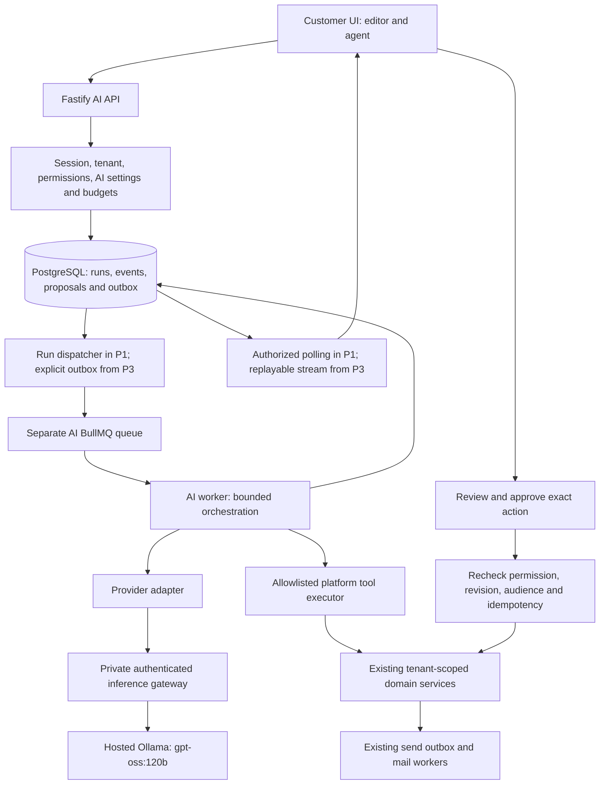

# Valasys AI: Ollama and DeepSeek Harness review and action plan

> Current implementation update: Durable server-side chat history, resumable runs, checkpoint compaction and idempotent draft approvals have been added without changing the design. See [session implementation review](AI_CHAT_SESSION_RELIABILITY_REVIEW.md) for current scope and remaining differences from the supplied harness.
> Implementation constraint: Preserve the existing customer AI and email editor design, reference HTML, generated views and CSS. Connect behavior through adapters. Review generated writing on the existing canvas, use the existing subject dropdown and Undo, and save through existing controls. The chat uses real responses and existing approval cards; unavailable account actions must never simulate success.


Review and revision date: 20 October 2026. **Active delivery target: two working days**, as requested by the user; the earlier multiweek schedule is withdrawn. Implementation is in progress; see [writing implementation and operations](AI_WRITING_OPERATIONS.md) for actual scope and verification. No production rollout has been performed. Start with the [two-day delivery plan](AI_DELIVERY_DECISION_SUMMARY.md). Section 0 defines the sprint scope; the subsequent architecture and P0–P5 package labels describe the expanded system and unscheduled capability backlog, not additional work promised within two days.

## 0. Active two-day delivery scope

Deliver the three connected editor operations—subject suggestions, selected-text rewriting and an email draft—against the user's hosted Ollama 120b model, with preview, acceptance, undo and the existing revision-aware template save. Use Valasys branding and neutral server-side provider interfaces. The existing configuration was found to use gpt-oss:120b-cloud through Ollama 0.14.2. The user explicitly authorized this cloud model; a local 120b deployment is not assumed. The two-day target also depends on a working platform environment. It is not a claim that the full account-agent architecture below can be implemented, evaluated and operated reliably in two days.

### Scope and execution

| Sprint window | Work and acceptance |
| --- | --- |
| Day 1, first hour | Verify actual private endpoint/model and worker-environment access, configure gateway credentials securely, run synthetic inference and record latency. Surface blockers immediately. |
| Day 1, remaining time | Direct Ollama provider, bounded output schemas, one tenant/owner-scoped run table, recoverable queue dispatch, separate AI worker, generation/status/cancel APIs, and focused backend tests. |
| Day 2, first half | Wire production editor generate/rewrite/subjects, poll status, preview/accept/undo, stale-editor checks, errors and existing template save. |
| Day 2, remaining time | Real-model production-route browser checks, tenant/ownership tests, duplicate/lost-job/cancel recovery, unsafe/truncated output and provider outage tests, conservative load test, internal flagged deployment and rollback. |
| Stretch only after required gates | Basic writing chat at `/ai-agent` using user-supplied text and the same provider, without live account tools or a durable-history promise; keep disabled if incomplete. |

There is no harness adoption, extra model, SSE replay, business-memory UI, analytics agent, workflow generation, campaign launch automation, approval subsystem, routines or retrieval in the committed sprint scope. Existing manual editor saves and send safeguards remain. Do not claim that future capabilities have shipped by exposing the design-reference agent.

### Minimal data and reliability

The sprint introduces **one `ai_runs` table**, not all four expanded-writing tables or the eventual inventory in Section 9. Include tenant/user ownership, idempotency key/request hash, bounded request/result JSON and schema version, current state, dispatch intent, attempt/fencing token, lease/deadline/cancellation, usage fields and expiry. Use trusted deployment configuration for enabled tenants, fixed model, conservative concurrency and per-operation/per-user limits. No customer AI billing, separate feedback/usage/settings tables or settings interface is required in this sprint.

Reuse existing PostgreSQL, Redis/BullMQ, tenant helpers, authentication and deployment patterns. Keep the AI worker in a separate process. Return a run ID immediately and poll authenticated status. A recurring dispatcher/sweeper recovers committed-but-not-enqueued runs and expired work; atomic claims and ownership tokens fence stale results. Keep the Section 11 recovery properties, with usage recorded once on the run rather than requiring a separate usage table. Avoid any inference call inside a database transaction or normal mail-worker process.

FORCE RLS/grants/startup verification, run-owner checks, input/output/deadline/concurrency limits, secure gateway access, meaningful errors, cancellation races, result validation and customer-content retention/export/erasure are part of the minimal implementation. They are not optional features deferred to meet the date. Include generated-content preflight with operation-aware advisory/blocking decisions; managed compliance footers and send-time checks remain in the existing delivery path.

Store only bounded data needed for the run and pending user acceptance. Do not log raw prompts by default. Use the existing privacy lifecycle implementation for the new table and define a short operational expiry appropriate to the approved deployment. Do not silently save complete chat history. A feature flag/tenant allowlist and disable control must be available before the first release.

### Definition of done and schedule risk

All three operations must run on the real hosted model from the authenticated production editor, support preview/accept/undo/save, and pass tenant/ownership, stale-document, invalid-output, timeout/outage, cancellation, duplicate-request and lost-enqueue tests. Verify restart/refresh behavior, deployment configuration, conservative saturation behavior and feature-flag rollback. A synthetic-provider demonstration is progress, not proof of real inference integration. No application or live-model tests are newly claimed by this schedule revision.

If private model access is unavailable, hardware cannot finish representative requests within bounded deadlines, or a required isolation/recovery test fails, report the actual blocker and do not label the release complete. External enablement also needs the applicable privacy/data-use review; target internal controlled deployment by the end of Day 2 if external release review is outstanding. Customer content remains subject to the approved access/lifecycle rules even internally.

The two-day scope supersedes the expanded P1/four-table/runtime prerequisites described below. P0–P5 remain descriptive work-package IDs for future capabilities, with no assigned duration. The complete future architecture is retained to keep the initial provider and run API extensible; it is not an instruction to build everything before connecting the editor.

## 1. Decision

Build a platform-owned AI service around the hosted Ollama model. Assume the intended model is `gpt-oss:120b` until the exact installed tag is confirmed. Keep the existing customer UI, authentication, PostgreSQL, Redis/BullMQ, and email delivery services. Connect the editor first, add grounded account questions next, and then introduce draft-building tools and explicitly approved live actions.

DeepSeek Harness is an orchestration framework; it does not require the DeepSeek model. This checkout contains a multi-provider adapter suitable for an Ollama compatibility proof. However, adopting the complete default coding-agent configuration would introduce capabilities that this marketing assistant does not need. Evaluate a restricted harness profile behind a platform-owned interface. Basic writing should ship through a direct Ollama provider without depending on a successful harness rollout.

The operating rule is: **the model requests operations; Valasys authenticates, authorizes, validates, records, and executes them.** A model response never grants permission or proves that a database write or email send happened.

### Recommended delivery order

1. Verify and benchmark the actual Ollama deployment; writing delivery does not depend on the harness.
2. Deliver subject suggestions, rewriting, and email draft generation in the connected editor.
3. Before chat, time-box the optional harness proof; then deliver persistent chat with read-only tools and source-linked answers using the selected orchestrator.
4. Deliver reviewed template, segment, campaign, and workflow drafts.
5. Deliver approval-bound scheduling/publishing after crash recovery and duplicate prevention pass.
6. Deliver recurring routines and knowledge retrieval only after the preceding controls are operating reliably.

## 2. Review scope and confidence

Inspected two repositories:

| Repository | Checked revision | Relevant scope |
| --- | --- | --- |
| Mail platform in the current workspace | `cbb59539cf957ce3c10b061d4c6c593666fec310` | Actual customer entry point and adapters, API registration and session/capability bridges, contacts/audiences/campaigns, templates/workflows/analytics, tenant transactions, queues, deployment proxies, existing AI plan |
| [DeepSeek Harness repository](https://github.com/deepseek-ai/deepseek-harness/tree/c291e7961a515f6d7af9304e7fd1d257929aef26) | `c291e7961a515f6d7af9304e7fd1d257929aef26` | Root instructions and architecture, safety notice, provider interfaces/configuration, SDK client, profile composition, persistence and tool controls, focused provider tests |

This is an architectural and integration review of relevant execution paths, not a claim that every file or production service has been audited. The hosted Ollama endpoint, GPU configuration, reverse proxy, installed model digest, and live customer environment were not supplied or tested. No customer messages were sent, no databases were migrated, no secrets were displayed, and no application behavior was changed during this review.

The harness working tree already contains untracked generated JavaScript/declaration artifacts under vendor source directories. Preserve those files while diagnosing build/source resolution; do not clean a developer's working tree automatically. Mail-platform tracked files were unchanged at the start of the review.

### Checks actually run

| Check | Result | Interpretation |
| --- | --- | --- |
| `npm run typecheck --workspace=@platform/customer-ui` | Passed | Current customer UI compiles; this does not demonstrate working AI |
| Harness: `pnpm exec vitest run packages/llm/llm-pi-ai/tests/config.spec.ts packages/llm/llm-pi-ai/tests/catalog.spec.ts packages/llm/llm-pi-ai/tests/compat-upgrade.spec.ts` | 3 files: 2 passed, 1 failed; 84 tests passed, 19 failed; 19 unhandled errors reported | Provider configuration/compatibility tests partly pass; catalog composition cannot be considered green |

Failing catalog tests report `Cannot read properties of undefined (reading 'PENDING')` at `scripts/test-invariants.ts:88`, with related `ACTIVE` errors. Inspection found a `const enum FiberState` in `vendor/cordis/src/fiber.ts`, generated adjacent JavaScript with inlined numeric states, and consumers importing the enum at runtime. Source/artifact resolution or stale generated output is a plausible cause, not a confirmed final diagnosis. Reproduce in an isolated clean checkout with pinned dependencies before changing code. These failures do not establish whether Ollama itself is compatible.

The execution host reported Node `v26.0.0` and pnpm `11.7.0`. The harness declares Node `^22.19.0 || >=24.0.0` and pnpm `11.7.0`; use a supported, pinned deployment version consistently across development and CI.

The full mail-platform test suite was not run: its global setup applies migrations to its configured database. Live inference, browser behavior, deployment streaming, failover, throughput, and security tests remain release requirements rather than completed evidence.

## 3. What the mail platform actually has today

### Customer AI is deliberately disconnected

| Surface | Current evidence | Required work |
| --- | --- | --- |
| Production application | `packages/customer-ui/src/main.tsx` renders `ProductionApp` from `faithful/App.tsx` | Integrate into this application, not the unused alternate `src/App.tsx` |
| AI agent route | `faithful/App.tsx` routes `/ai-agent` to `FeatureUnavailable` | Add an authenticated production agent component and feature gate |
| Reference agent | `faithful/generated/Agent.tsx` is compiled from `AI Agent.dc.html`; uses local storage, seeded content, scripted actions, and an optional `window.claude.complete` hook | Reuse its visual design; replace the controller behavior and data model |
| Email editor | `faithful/email-adapter.ts` overrides `generate`, `rewrite`, and `suggestSubjects` with a not-configured message | Wire all three to real generation runs, previews, and accepted editor changes |
| Workflow builder | `faithful/workflow-adapter.ts` overrides `aiBuild` and `aiSubject` with a disconnected-provider message | Generate validated draft documents; preserve save, revision, simulation, and publish behavior |
| Support AI | `packages/shared/src/inference.ts` defaults to `LocalHeuristicInferenceProvider`; support/admin code calls its narrow triage/reply methods | Keep this separate or adapt it later; it is not a customer chat or tool runtime |
| AI infrastructure | No customer AI run/conversation/approval API was found in the reviewed API registration and route files | Add the service, durable data, worker, configuration, and operating controls |

Generated design files are overwritten by `design:compile`. Follow the existing production-adapter pattern, or build dedicated React components. Do not implement durable AI behavior by editing generated JSX or adding calls to a browser-only global model API.

### Existing services can support useful AI tools

| Capability | Existing implementation | Constraints the assistant must expose honestly |
| --- | --- | --- |
| Customer login and organization | `faithful/store.ts`, `api/plugins/session-auth.ts` | Bearer session, MFA, active organization and current role; scope every run to the selected organization |
| Capability checks | `shared/src/memberships.ts`, `routes/console-data.ts` | Existing capabilities include `send`, `logs:read`, and `settings:manage`; add explicit AI policy without broadening existing roles accidentally |
| Contacts and audiences | `customer-contacts.ts`, `customer-audiences.ts` | Segments support creation/open/click rules with fixed day ranges; do not promise arbitrary behavior conditions or CRM enrichment |
| Email templates | `routes/templates.ts`, `faithful/email-adapter.ts` | Real storage, versions, expected revisions, HTML/text validation, editor project documents |
| Workflow building | `customer-workflow-builder.ts`, `workflow-adapter.ts`, `workflow-codec.ts` | Draft and immutable published versions, simulation, actual supported step types; no invented SMS/purchase/cart events |
| Campaigns | `customer-campaigns.ts`, migrations 101–103 | Existing small one-off sends and schedules; regular audience limit 200, subject A/B limit 100 with at least two recipients; no automatic winner selection |
| Personalization | Campaign launch renders the stored template with an empty variables object and rejects missing variables | Per-contact AI personalization needs a separate implementation; do not claim it is available |
| Analytics | `routes/analytics.ts` | Existing periods include 24h, 7d, 30d and bounded dimensions; retention and PostgreSQL/ClickHouse behavior apply |
| Delivery | Existing send routes, outbox, BullMQ and mail workers | Use existing sender, consent, suppression, quota, compliance, and delivery checks; queued is not delivered |
| Tenant isolation | `api/lib/tenant.ts`, `shared/src/tenant-context.ts` and migrations | Use the transaction executor with transaction-local tenant settings; explicit tenant predicates remain necessary |
| Operations | Existing metrics/tracing, Compose, Helm, Nginx | Add isolated AI resources and streaming configuration; do not make model availability a dependency of mail readiness |

The older `AI_ARCHITECTURE_AND_IMPLEMENTATION_PLAN.md` predates these changes. Its claims that there is no production customer build or contacts/audiences/campaign APIs are no longer accurate for this checkout. Its direct-DeepSeek-provider recommendation is also superseded by the hosted-Ollama requirement.

### Gaps that matter before expanding automation

1. New AI tables must be added to the startup RLS verification inventory. The current `rlsIsEnforced()` list is explicit; a migration alone does not extend that startup check.
2. Existing global API rate limiting uses `skipOnError: true`. AI admission and GPU-budget checks need an independent fail-closed policy when their quota store is unavailable.
3. The customer API helper has a 20-second request timeout. Do not hold a generation POST open until a large model finishes; return a durable run identifier quickly and stream/poll separately.
4. Campaign launch intentionally leaves ambiguous crash outcomes claimed instead of automatically redispatching. Add reconciliation before allowing AI to schedule campaigns reliably; never turn an uncertain launch into a blind retry.
5. Audience preview and eventual send are distinct moments. A live audience can change; approval needs a defined recipient snapshot or a fresh review when the audience changes.
6. Some useful operations currently live in route handlers. Extract reusable domain functions where needed so a background AI tool does not copy validation logic or manufacture an API-key/session context.

## 4. What to learn from existing AI products

These are observable product and documented engineering patterns, not claims about competitors' private implementation.

| Source | Documented pattern | Application here |
| --- | --- | --- |
| [Customer.io agent](https://docs.customer.io/ai/agent/get-started/) and [MCP access](https://docs.customer.io/ai/mcp/get-started/) | User permissions constrain the assistant; draft work and live-resource editing have different controls; sending follows normal flows | Use the current user's permissions, account-level AI settings, typed draft previews, and explicit action review |
| [Apollo assistant](https://knowledge.apollo.io/hc/en-us/articles/39359204112397-AI-Assistant-Overview) and [writing assistant](https://knowledge.apollo.io/hc/en-us/articles/15396174946445-Use-the-Writing-Assistant-to-Compose-Emails) | Saved business messaging and existing account context guide writing and recommendations | Add a tenant-owned business profile and useful editor actions alongside chat |
| [Anthropic engineering](https://www.anthropic.com/engineering/building-effective-agents) | Simple calls/workflows often suffice; open-ended agent loops add latency and operating complexity | Use deterministic writing workflows first; introduce bounded tool orchestration for requests that need it |
| [OWASP excessive agency](https://genai.owasp.org/llmrisk/llm062025-excessive-agency/) | Too much functionality, authority, or autonomy amplifies failures | Minimize tools, enforce authorization in services, and require review for consequential operations |

The resulting product is a context-aware writing assistant plus a constrained operator over existing services. An attractive chat panel alone does not supply data access, permissions, durable execution, or reliable results.

## 5. Architecture and ownership



### Components

| Component | Owns |
| --- | --- |
| Customer UI | Input, progress, cancellation, history, preview, acceptance and review cards |
| Fastify AI routes | Authentication, ownership, admission, short requests, stream authorization, action approval |
| AI domain service | Run state transitions, context assembly, proposals, policy decisions, replay, usage settlement |
| AI worker | Leased execution, provider calls, bounded tool loop, normalized events, recovery |
| Ollama adapter | Transport parsing, supported parameters, cancellation, model metadata, usage and error normalization |
| Optional harness runtime | Agent loop and event/tool orchestration inside a restricted process; never final authorization |
| Tool executor | Typed input validation, current permission checks, tenant-scoped service invocation and result redaction |
| Platform services | All actual writes, send safeguards, domain rules and authoritative results |

Use separate AI worker processes and CPU/memory budgets. A new `packages/ai-worker` workspace is preferable; sharing source utilities with `packages/worker` is reasonable, but running GPU-bound or long-lived AI work in the existing mail-worker process is not the target deployment. Add the new workspace to build and deployment assets explicitly.

No browser-to-Ollama requests, no customer-supplied inference base URLs, no arbitrary SQL tool, no generic shell/file/network tools, and no delivery credentials in the inference process. No automatic external-cloud fallback: customer content must not leave the agreed hosting environment silently.

### Writing alpha versus later runtime

P1 uses PostgreSQL run records, a dedicated BullMQ queue, a recoverable run dispatcher and authenticated polling. The `ai_runs` row contains the validated request snapshot, bounded result, policy versions, deadlines and attempt ownership. Full conversation history, tool records, event replay, SSE, and a separate outbox table arrive in P3. The P1 run record doubles as a small durable dispatch ledger; simplified scope does not mean accepting lost jobs or uncontrolled duplicate work. The step-by-step recovery rules are in Section 11.

The request flow in P1 is: editor → authenticated API → committed run/budget reservation → recoverable enqueue → worker claim → private inference gateway → validation/content preflight → saved result → authorized poll → user acceptance → existing template save. P3 adds chat context, tool orchestration and streaming; P5 adds separately approved domain actions. The diagram shows the eventual architecture, not prerequisites for the first subject suggestion.

## 6. Ollama integration specification

### Confirm before implementation

Record the server URL reachable from the AI-worker container, exact Ollama version, exact model tag and digest, quantization, GPU count/type/VRAM, system memory, GPU offload, context setting, inference proxy authentication, competing workloads, and expected concurrent users. Confirm the model is actually local rather than a cloud-tagged model. An endpoint reachable from a developer laptop may still be unreachable from deployed containers.

The user has selected hosted GPT-OSS 120b. Keep that as the initial approved model. In P0, benchmark a smaller candidate such as GPT-OSS 20b for short writing if infrastructure access and product approval permit it; adding or downloading a model is a deployment decision, not an assumption of this plan. Route operations by trusted configuration after quality/capacity tests. One approved 120b model remains a valid starting configuration.

| Operation | Candidate routing after P0 | Bounded output |
| --- | --- | --- |
| Subject suggestions | Smaller candidate if it meets quality/latency gates; otherwise approved 120b | Three to five subjects with a fixed character/byte limit |
| Selected-text rewrite | Same candidate policy | Absolute token/byte cap plus an input-relative limit |
| Full draft | Approved 120b initially | Allowlisted block document with total block/text limits |
| Account questions and proposals | Approved 120b initially | Per-turn output and total run budget |

Do not require both models to remain loaded from day one. A roughly 65 GB 120b artifact and another model plus both KV caches may not fit on one 80 GB GPU. Benchmark the actual serving allocation, model-switch delays, mixed-operation workloads and eviction behavior. Choose dedicated small-model capacity, controlled switching or a single-model deployment based on evidence. Two model tags on one constrained GPU are not two independent capacity pools. No automatic routing to unapproved external or cloud models.

The public [Ollama model listing](https://ollama.com/library/gpt-oss:120b) identifies the 120b artifact as about 65 GB and describes deployment on an 80 GB GPU. That is a model-fit reference, not evidence that the user's hardware can serve a particular latency or concurrency. KV cache, context, concurrent sequences, and other allocations require additional capacity planning.

### API choices

| Use | Proposed API | Reason |
| --- | --- | --- |
| Direct writing provider | Native `/api/chat` | Explicit schema `format`, generation options, keep-alive and detailed timings |
| Harness compatibility proof | `/v1/chat/completions` through `llm-pi-ai` | Existing harness adapter supports hand-declared OpenAI-compatible routes |
| Discovery/preflight | `/api/version`, `/api/tags`, `/api/show`; optional `/api/ps` | Verify installed model, capabilities, controls and loaded state |

[Ollama OpenAI compatibility](https://docs.ollama.com/api/openai-compatibility) covers a subset of the OpenAI API, including chat streaming, tools, response formatting, and reasoning controls. Do not assume every SDK field, strict tool mode, parallel-call behavior, or Responses API persistence is supported by the installed release. Own conversation state in Valasys.

[Native chat](https://docs.ollama.com/api/chat) supports structured `format`, `think`, and `keep_alive`. [Structured-output guidance](https://docs.ollama.com/capabilities/structured-outputs) demonstrates JSON-schema generation and application validation. Confirm the exact schema subset and interaction with the selected reasoning mode in integration tests. Well-formed JSON is not proof that a proposed operation is authorized or semantically correct.

### Provider interface

Define a customer-AI provider independently of the existing support-triage interface:

```ts
interface AiProvider {
  capabilities(): Promise<ModelCapabilities>;
  stream(request: AiRequest, signal: AbortSignal): AsyncIterable<AiProviderEvent>;
}
```

Version and validate these application types. Normalize answer deltas, tool-call assembly, final usage, finish reason, retryable errors, cancellation and unsupported capability errors. Use a maintained client or a small transport adapter; do not reimplement the whole inference stack. Native Ollama chat streams NDJSON; the compatibility chat endpoint streams SSE. A TCP chunk is not a complete JSON record: handle split UTF-8, partial records, multiple records and incomplete EOF correctly.

Capture prompt/output token counts, load duration, queue delay, first visible answer time, generation duration, total run duration, and missing-usage status. Do not label missing usage as zero or successful completion. Do not treat connection EOF, timeout or token exhaustion as a valid completed draft.

[Ollama thinking controls](https://docs.ollama.com/capabilities/thinking) vary by model and version; discover supported values. Start evaluation with low reasoning for short writing and medium for planning, then select based on quality and latency. Separate reasoning transport data from final user-facing answers. Do not manufacture a generic `thinking: disabled` DeepSeek field or assume every reasoning model accepts a boolean disable control.

### Hosted inference protection

[Ollama local authentication](https://docs.ollama.com/api/authentication) does not require a local API credential. Put the hosted server on a private network and authenticate the worker at a TLS gateway or service-mesh boundary. A dummy SDK key does not secure the service. Restrict inference egress and expose only necessary paths: customer workloads must not pull/delete models, change configuration, or access arbitrary administrative endpoints. Validate configured hosts at startup and do not accept model endpoint changes from ordinary customer prompts/settings.

Disable unapproved cloud features and external tools in the deployed configuration, restrict outbound network access, and verify this with network tests. Self-hosted weights alone do not prove that all surrounding telemetry, logs and tools stay private.

### Capacity and admission

[Ollama FAQ](https://docs.ollama.com/faq) documents queue and parallelism controls, including `OLLAMA_NUM_PARALLEL`, `OLLAMA_MAX_QUEUE`, and memory growth with context and concurrent requests. Configure these deliberately. Use Valasys admission before Ollama's internal queue, with per-user/per-tenant limits and a global inference semaphore. Multiple worker replicas must share the same global limit.

Provisional evaluation settings, not production guarantees: one active run per conversation, one active generation per user, a conservative per-tenant limit, an initial effective context around 8K–16K tokens, small output caps for subjects and larger bounded caps for full drafts. Select limits after measurement. Output and reasoning consume generation budget; reserve space for both. Avoid advertising the model's maximum context when the server is configured for less.

Benchmark warm and cold runs at concurrency 1, 2, 4, then higher only when stable. Use short subjects, 1K-token rewrites, long HTML drafts and multi-tool account questions. Record p50/p95/p99, errors/OOMs, fairness, token throughput, cancellation release time, and mail-service performance during saturation. Queue arrival rate must remain below sustainable service rate; adding API replicas does not increase GPU capacity.

If one inference node fails, show degraded AI and preserve drafts. Genuine inference availability requires a second tested serving node or accepted downtime. A gateway retrying the same failed node is not failover.

## 7. DeepSeek Harness adoption plan

### What is reusable

- `packages/llm/llm-pi-ai`: hand-declared provider routes, model metadata, reasoning compatibility and stream translation.
- `packages/core`: tool registry, agent/session vocabulary, event-driven extension points.
- `packages/sdk/client`: subprocess lifecycle and stdio JSON-RPC client.
- Session persistence, compaction, tool timeouts and retry-policy mechanisms, after checking their behavior against platform requirements.

The [safety notice at the inspected revision](https://github.com/deepseek-ai/deepseek-harness/blob/c291e7961a515f6d7af9304e7fd1d257929aef26/SAFETY.md) explicitly calls the harness experimental and unaudited. Its default profiles target coding agents. In particular, `packages/bundle/sdk-minimal/cordis.patch.yml` includes local subprocess and persistent shell tools and configures `danger-full-access`. The word "minimal" is not a production security property.

Schedule a maximum five-engineer-day proof during P2, before P3, outside P0 and the writing-alpha critical path. The default decision is defer if the proof misses its gates. Count this allocation against the same two-engineer team; it is not free parallel capacity. Use a pinned supported runtime consistent with CI. Node v26 used in the original review satisfies the declared `>=24` range; the failures are not evidence that Node v26 is unsupported. Compare runtime versions only as a controlled diagnostic experiment.

### Integration choice

| Option | Advantages | Costs | Recommendation |
| --- | --- | --- | --- |
| Direct Ollama calls with fixed application workflows | Small dependency surface, straightforward structured writing, easier debugging | Platform owns a bounded tool loop when needed | Use for first writing release and as the initial reference implementation |
| Restricted harness behind an adapter | Existing session/tool orchestration, compaction and event mechanisms | Preview APIs, lifecycle/process management, data duplication, compatibility/security testing | Run a time-boxed proof; adopt for chat/tool work only if it passes the same evaluations |
| Embed the harness web UI/server as the customer platform | Existing generic agent interface | Separate identity/storage, coding defaults, difficult product integration | Do not use for this customer integration |

The platform API and run format must be identical regardless of orchestrator. This prevents the harness from becoming a prerequisite for editor assistance or locking customer records to its preview session format.

### Required restricted profile

Create an explicit, versioned `valasys-ai` profile with only the agent kernel, approved provider, necessary persistence/compaction, bounded execution controls, and the Valasys tool plugin. Inspect the fully resolved profile at build time and reject unwanted tools. Disable shell, file access, arbitrary web fetch, subagents, self-modification, plugin installation, user-editable executable configuration, inherited credentials and coding prompts. Enforce network and process restrictions outside the harness as well.

Follow the repository's supported `dsh --profile ...` launch mechanism. The TypeScript SDK launches a runtime subprocess; it is not a stateless HTTP model client. Use a pinned same-version runtime and a minimal replacement environment. Give each tenant-isolated runtime an isolated Harness home and storage directory; do not reuse a developer home. For the initial proof, use one process per active run, or a small bounded tenant-isolated pool if startup cost demands it. Measure startup/memory overhead before selecting pooling.

The SDK documentation says subscriptions see runtime notifications and client-side filtering scopes session trees. Therefore, filtering event IDs in a shared browser/client is not tenant isolation. Valasys must own all process/session mappings and reject mismatched tenant, conversation and run IDs before sending events or executing tools.

The high-level SDK's `finalResponse` is the last root assistant text during an activity interval, not a causal response guarantee for an individual prompt. Serialize runs per conversation, correlate accepted prompt IDs with events, bound all waits, and do not equate `idle` with successful completion. The SDK profile's `maxTokensAsSuccess` default must be overridden or the event adapter must reject truncated output explicitly.

Treat PostgreSQL as authoritative for customer runs, proposals, actions and usage. If harness JSONL logs are retained, version them, isolate them, restrict access, and include them in retention/deletion. Decide deliberately whether to store replayable restricted traces or use short-lived operational traces; do not create an undocumented permanent second copy of customer content.

### Illustrative provider fragment for the proof

This is a proposal based on the inspected configuration types, not a tested deployment file. Its row must be part of the restricted profile; it does not make an existing SDK profile safe.

```yaml
- id: valasys-ollama-provider
  name: '@deepseek-ai/dsh-llm-pi-ai'
  config:
    providers:
      valasys-ollama:
        apiKeyEnv: VALASYS_INFERENCE_GATEWAY_TOKEN
        api: openai-completions
        baseURL: https://inference.internal.example/v1
        reasoning: low
        defaultContextWindow: 16384
        defaultMaxTokens: 2048
        retryPolicy:
          mode: normal
          maxRetries: 1
        compat:
          supportsStore: false
          supportsDeveloperRole: false
          supportsReasoningEffort: true
          supportsStrictMode: false
          maxTokensField: max_tokens
          thinkingFormat: openai
        models:
          - id: gpt-oss:120b
            name: Valasys hosted GPT-OSS
            contextWindow: 16384
            maxTokens: 4096
            input: [text]
            reasoningEfforts:
              low: low
              medium: medium
              high: high
```

Set the actual gateway URL/model from trusted deployment configuration, select `provider: valasys-ollama` at initialization, and align catalog context with the server setting. Prove whether usage/reasoning replay/tool-result naming compatibility flags need adjustment. Do not use `llm-deepseek` just by swapping its URL: it serializes DeepSeek-specific thinking fields and reasoning replay semantics that are a poor default for GPT-OSS.

### Harness adoption gates

1. Reproduce and resolve the 19 catalog failures in an isolated checkout; run focused provider, lifecycle, stream and profile tests.
2. Pass real Ollama text, schema, sequential tool, malformed argument, tool replay, reasoning, usage, truncation and cancellation tests.
3. Prove the resolved profile cannot execute shell/files/network/admin operations or access another tenant's data.
4. Prove crash/retry behavior and bounded process cleanup under load.
5. Compare quality and p95 latency with direct Ollama using the same evaluation tasks.
6. Pin commit, lockfile, profile, runtime and model digest; document upgrades and session-format compatibility.

If these gates fail, keep the direct provider and fixed workflows while fixing the proof separately. Do not delay useful, safe editor generation indefinitely to adopt the framework.

## 8. End-to-end user flows

### A. Suggest subjects or rewrite selected copy

1. The user opens a real template and requests suggestions. The browser sends the selected text/current unsaved content, requested operation, client request ID, template ID/revision if saved, and editor-context fingerprint. It does not send a tenant ID as authority.
2. The API resolves the current session/MFA/organization, checks AI enablement and writing permission, validates size and policy, reserves budget, and commits the run in a short transaction. P1 dispatch intent is on the run row; from P3 a separate outbox record is committed in the same transaction.
3. Return `202` with `run_id` and status URL. P1 polls that URL with bounded backoff; from P3 an event URL is also available. The dispatcher enqueues only the run ID. No database transaction remains open during model inference.
4. The worker claims the run atomically, rechecks current access, loads the immutable content/policy snapshot, applies prompt/output limits, and calls Ollama. P1 uses validated request context and platform writing instructions; from P2 it also snapshots the approved versioned business profile.
5. The service stores stage/status and a bounded result in P1; from P3 it also stores replayable events. Only a completely validated, content-checked result becomes insertable. Partial streamed content from later phases remains provisional.
6. The user selects an option or accepts a rewrite. Verify the editor fingerprint/selection is still current; if it changed, offer a comparison rather than replacing newer work. Apply through GrapesJS/editor operations with undo support.
7. The existing template-save API persists the result using expected revision. Generation itself does not silently overwrite a saved template.

Use operation-specific output schemas: bounded subject arrays; rewrite text; or subject/preheader/text plus an allowlisted email-block document. Prefer deterministic HTML rendering from blocks for full drafts. If accepting HTML, sanitize it and URLs before preview, disallow scripts/handlers/unsafe protocols, restrict remote assets and preserve merge tags, unsubscribe/footer elements and required fields. Handlebars compilation alone is not HTML sanitization.

### Content preflight before editor acceptance

Reuse `scanContent` from `shared/src/abuse.ts` and `classify` from `shared/src/classifier.ts` through a side-effect-free preflight service. Apply checks to the candidate merged into the current document where full-document context matters. Confirm the existing classifier's actual local word/domain-reputation coverage; it is not a comprehensive external URL-reputation or inbox-placement guarantee. Extract any additional checks deliberately rather than claiming they already exist.

Malformed schema, unsafe markup/URLs and explicit blocked-content policy are hard failures for insertion. Spam heuristics and unsupported marketing claims produce actionable warnings unless the account's defined policy makes them blocking; record the exact policy/decision. A subject or rewritten paragraph does not need its own postal address/footer. Preserve protected footer/merge-tag content in the merged draft, and show full-message readiness separately.

`shared/src/canspam-footer.ts` appends the trusted footer after rendering/tracking in the delivery path. Editor preflight must not fabricate recipient unsubscribe tokens or require a complete send-specific footer in every generation. Preview the managed footer with safe placeholders as appropriate, flag missing account/sender prerequisites, and keep the authoritative footer, recipient consent/suppression, quota and compliance checks at send time. Never call the send endpoint merely to validate a draft or consume mail quotas. Rerun relevant checks on accepted content and again at send because later edits and account state can change it.

### B. Ask why a metric changed

1. The request enters a tenant-owned conversation and a durable run.
2. The orchestrator selects from available read tools; the service validates time windows and dimensions against actual endpoint support.
3. Authorized domain services return aggregated values, units, definitions, source IDs, requested/actual windows, retention limits and freshness timestamps.
4. Compute rates, comparisons and totals in code. Ask the model to explain these results with references to the returned evidence.
5. Show source cards linked to actual analytics views. Do not invent recipient counts, causal explanations, benchmark guarantees or unsupported date comparisons.
6. If data is missing or stale, state that specifically. A tool failure must not be replaced by a plausible fabricated metric.

Existing open/click tracking and bot classifications affect interpretation. Define unique-vs-event counts, denominator rules, window timezone and late event handling before adding comparative tools.

### C. Build a re-engagement campaign

1. Translate the request into supported segment rules; ask for missing offer, CTA, audience or time details.
2. Preview consent-eligible audience count through a typed tool. Keep personal recipient records out of model context by default.
3. Generate a validated template and campaign proposal referencing real tenant-owned resources. Display copy, audience criteria/count, sender, schedule and limits.
4. Saving a draft is a real mutation: make it explicit in the UI and apply through an authenticated, revision-aware service. Label generated-but-unsaved content accurately.
5. For a launch proposal, bind approval to exact template version/content, campaign revision, sender, canonical schedule, recipient snapshot/hash, action arguments, policy version and expiry.
6. The user reviews and approves a server-generated action card. The approval endpoint rechecks current membership, MFA, account status, AI policy, resource revisions and action capability.
7. Atomically consume approval and create an action execution/outbox record. The domain service sends using the stable idempotency key through the existing send pipeline.
8. Return accepted/queued message references and partial outcomes. Delivery results arrive later from the normal platform events.

Initially route users to the existing campaign launch UI with a reviewed draft. Enable direct chat approval only after snapshot binding and reconciliation exist. Reject audiences beyond the current limits instead of silently sending a subset or bypassing the cap.

### D. Generate a workflow

Generate only the backend-supported workflow definition and builder representation. Validate graph/node IDs, limits, triggers, templates, conditions and URLs; compile using the established codec, simulate, and show a readable diff. Save as a draft with expected revision. Publishing creates an immutable version through the existing publish service and requires separate review. Existing runs keep their original version. A generated preview is not an activated workflow.

### E. Routines, skills and memory

Introduce these after the core system works. Memory is an explicit editable business profile, not automatic storage of every conversation. Skills are versioned tenant-owned text instructions/templates, not downloadable executable plugins. Routines are scheduled prompts with explicit owner, timezone, tool policy, limits and destination. Recheck the owner's current permissions every execution; report-only by default and obtain new approval for live actions. Handle duplicate ticks and daylight-saving transitions with stable occurrence IDs. Do not reuse approval from an earlier scheduled run.

## 9. Data and API plan

### Proposed tenant tables

| Table | Main fields and invariants |
| --- | --- |
| `ai_settings` | Customer ID, enabled features, policy version, budgets, PII access policy, updated by/at |
| `ai_business_profiles` | Customer ID, version, company/product facts, tone, locale, approved claims, restrictions; record source and editor |
| `ai_conversations` | Customer ID, ID, owner user, title, visibility, timestamps; private to owner initially |
| `ai_messages` | Customer/conversation IDs, sequence, role, validated content/artifact references, client request ID |
| `ai_runs` | Customer/user/conversation IDs, operation, request hash, provider/model digest, prompt/context versions, status, attempt/lease, budgets and error |
| `ai_run_events` | Customer/run IDs, monotonic sequence, event type/version, redacted payload; unique `(customer_id, run_id, sequence)` |
| `ai_tool_calls` | Run ID, tool-call ID, typed arguments, policy decision, status, sanitized result reference |
| `ai_artifacts` | Generated structured draft, schema version, base revision, context fingerprint, acceptance status |
| `ai_action_proposals` | Exact action, argument hash, dependency versions, audience snapshot reference, expiry, status |
| `ai_approvals` | Proposal hash, approver, MFA/permission evidence, decision and consumed timestamp; one-use execution constraint |
| `ai_action_executions` | Stable idempotency key, proposal, domain result/message IDs, execution/reconciliation status |
| `ai_usage` | Reserved/settled tokens and inference time, availability of counts, operation/model, outcome |
| `ai_outbox` | Durable run/action dispatch, claim state, attempt and next delivery time |
| `ai_feedback` | Run/artifact reference, rating, reason, optional edited acceptance |

The table above is the eventual inventory, not a P1 migration checklist. P1 introduces only `ai_settings`, `ai_runs`, `ai_usage` and `ai_feedback`. Store the bounded input snapshot and validated result on `ai_runs`, including result schema/content policy versions, result expiry, owner, request hash, dispatch intent/attempts, lease/fencing fields and cancellation/deadline state. P1 feedback references the run; it does not require a future artifact table. P2 adds versioned business profiles. P3 adds conversations, messages, event replay, tool calls and the explicit outbox. P4 adds reusable artifact records; P5 adds proposals, approvals and executions. Plan a tested, additive transition from run-contained results to artifact references while preserving existing run IDs and API result fields.

Add skills/routines/knowledge-document tables later, with the same ownership and lifecycle rules. Use composite tenant foreign keys and indexes for tenant/run lookups and pagination. Extend `shared/src/schema.ts`, migration grants, FORCE RLS policies, startup RLS checks, exports, retention and erasure together for every phase. P1 already stores customer content, so its deletion/export/retention controls cannot wait for P2 or P3. Resolve migration numbers at implementation time; do not assume 104 will still be free.

Conversation privacy needs both tenant isolation and user ownership checks. Tenant RLS alone would allow unrelated colleagues to read private chats if an endpoint forgot the owner filter. Define admin access explicitly rather than granting it accidentally.

### Proposed endpoints

Browser URLs use `/api/account/ai/...`; the existing proxy maps these to `/v1/account/ai/...`.

| Method/path under `/v1/account/ai` | Purpose |
| --- | --- |
| `GET /capabilities` | Tenant-enabled operations, permissions, supported tools and degraded state; no credentials |
| `GET /settings`, `PATCH /settings` | Account AI policy, admin-only changes |
| `GET /business-profile`, `PUT /business-profile` | Versioned approved business context |
| `POST /conversations`, `GET /conversations` | Create/list authorized history with cursor pagination |
| `GET /conversations/:id/messages` | Paginated authorized transcript |
| `POST /conversations/:id/messages` | Append request and create one durable run |
| `POST /generations` | Structured editor operation without requiring a chat UI |
| `GET /runs/:id` | Authoritative state, attempt, artifacts and error |
| `GET /runs/:id/events?after=N` | Authorized event replay/live stream |
| `POST /runs/:id/cancel` | Persist cancellation request; abort/reconcile execution |
| `POST /proposals/:id/approve`, `POST /proposals/:id/reject` | Decide exact server-stored proposal |
| `POST /runs/:id/feedback` | Record user feedback |

All writes use client request IDs/idempotency keys scoped to tenant and operation. Same key plus same payload returns the original result; same key plus changed payload returns conflict. Check every nested ID against customer, owner, run and proposal relationships. Cap list sizes, content bytes, result size and event connection counts. Keep inference details/stack traces out of customer errors.

Phase the endpoints with their tables: P1 capabilities/generation/status/cancel/feedback; P2 settings UI/business profile; P3 conversations/messages/events; P5 approval/rejection. P1 account AI settings are provisioned through a restricted operational path with a support/admin disable control; a polished settings UI may follow in P2. Public results expose a versioned product DTO, not raw database rows, prompt snapshots, provider errors or model digests.

For P1 polling, start around one second, back off to a capped interval with jitter, allow at most one outstanding poll per run, and stop on terminal state, logout or organization switch. Pause or slow background-tab polls, handle `429`/`Retry-After`, resume from status after reload, and cap abandoned-run lifetime on the server. Polling must not rerun inference or settle usage. Validate ownership for every poll and result fetch.

### Streaming and smooth UI

The current app uses Bearer tokens. Native browser `EventSource` cannot attach the required Authorization header; use authenticated `fetch` with a streaming SSE parser, or deliberately design a secure cookie-based alternative. Do not put session tokens in query strings. Event IDs must be durable monotonic sequence numbers, and reconnect starts after the last committed event. Redis pub/sub may wake a streamer but is not the event source of truth.

Event types should include `run.queued`, `run.started`, `answer.delta`, `tool.started`, `tool.finished`, `artifact.ready`, `approval.required`, `run.completed`, `run.failed` and cancellation states. Flush transient deltas for responsiveness but persist/coalesce within bounded latency; final completion/artifact events are durable before being published. Reconnection can replace a provisional answer with a canonical saved snapshot.

Configure dedicated AI streaming locations in customer Nginx and every external ingress: disable response buffering/cache, use HTTP/1.1 upstream where appropriate, flush heartbeats, and set read/idle timeouts consistent with the bounded run policy. The example API proxy currently has `proxy_read_timeout 30s`; changing the application alone will not fix interrupted streams. Verify Fastify error, headers, CORS and disconnect behavior on the streaming route.

Show real stages: queued, generating, reading named resources, waiting for review, completed or failed. Preserve the prompt and completed artifacts after refresh. Supply stop, reconnect, controlled retry, empty state, keyboard access and screen-reader status. On logout or organization switch, close streams, clear scoped cache and discard late events from the previous identity. A browser disconnect normally stops observation; cancellation is a separate explicit operation.

## 10. Tools, permissions and approvals

### First tool catalog

| Tool | Behavior | Permission/policy |
| --- | --- | --- |
| `get_business_profile` | Read explicit business facts | AI enabled; authorized profile access |
| `list_templates`, `get_template` | Bounded tenant templates | Existing template capability plus AI policy |
| `get_delivery_summary`, `get_usage` | Aggregated metrics | `logs:read`, retention and bounded periods |
| `preview_audience` | Count/criteria only by default | Authorized audience access; no automatic recipient dump |
| `get_campaign`, `get_workflow` | Read actual resource status/version | Current domain permissions |
| `propose_template`, `propose_segment`, `propose_campaign`, `propose_workflow` | Produce a validated unsaved proposal | Draft policy; no live side effect |
| `save_draft` | Save accepted proposal through domain service | Current write capability; explicit user acceptance |
| `simulate_workflow` | Existing side-effect-free simulation | Existing workflow capability |
| `propose_schedule` / `propose_publish` | Prepare an exact review card | Capability to propose, no execution |

The model never receives a generic `approve` tool. Actual approval is a browser/user operation against server-stored data. Initial release excludes account/security/billing changes, suppression removal, consent overrides, bulk deletion, webhooks to arbitrary URLs, and external research.

Implement typed schemas, unknown-field rejection, cross-field validation, resource ownership, row/time limits, deadlines, output redaction, declared side effects and idempotency policy for every tool. Execute partial streamed arguments only after a complete tool call is parsed and validated. Independent reads may run concurrently within budgets; writes execute in a controlled order. Do not assume a tool-call ID generated by the model is globally unique.

Existing capabilities are coarse. Add `ai:use` and `ai:manage` if product policy requires them, but every domain tool must also satisfy its normal permission. Analyst/billing users must not gain `send` through AI. Recheck current membership on each execution and approval, including background work; do not persist the browser's long-lived Bearer token in a queue. Use short-lived, server-minted internal authority scoped to tenant, actor, run, tool and permitted arguments, validated against current account state.

Bind approval to exact arguments and dependencies, not the model's free-text summary. Render server-generated impact details, audience count/hash, recipient policy, sender, content revision, schedule, expiry and any domain restrictions. If anything material changes, return conflict and require a new proposal. Expired/revoked/cancelled runs cannot execute approvals. Replayed approvals return the original execution result without repeating the action.

## 11. Reliability and recovery requirements

### Run lifecycle

```text
queued -> running -> completed | failed | timed_out
                  -> awaiting_approval -> queued continuation | rejected | expired
queued/running/awaiting_approval -> cancellation_requested -> cancelled
```

Use a separate action-execution state for consequential writes: `pending`, `executing`, `succeeded`, `failed`, or `reconciling`. Completion of inference does not imply action completion. From P1, serialize run claims and terminal writes with row locks or compare-and-swap, an attempt/fencing token and a bounded run lease. A stable BullMQ job ID reduces duplicate enqueues but is not an exactly-once guarantee: removed jobs can be re-added and stalled jobs can be retried while an old worker remains active. Only the current attempt may publish the canonical result or settle usage. These safeguards address documented [job-ID reuse](https://docs.bullmq.io/guide/jobs/job-ids) and [stalled-job recovery](https://docs.bullmq.io/guide/jobs/stalled) behavior. An approval wait releases GPU/process slots; a later continuation reconstructs context and revalidates permissions.

### Minimum P1 dispatch and recovery protocol

1. Admit the request with a tenant/actor/operation-scoped idempotency key and request hash. Commit the run snapshot, deadline, pending dispatch intent and durable budget reservation together. Coordinate Redis concurrency reservations with explicit expiry/reconciliation; if reservation or commit is uncertain, do not start inference until authoritative state is resolved.
2. After commit, attempt enqueue with a stable run-derived job ID. A scheduled dispatcher scans pending or aged queued runs and retries bounded enqueue after failures. Do not assume a duplicate `queue.add` result revives an existing failed/completed job: inspect its state and retry/recreate safely while PostgreSQL still authorizes work. Keep the same logical run ID and accounting key.
3. Worker claims the run in a short tenant-scoped transaction, increments an attempt token, records lease expiry and transitions to running only if not cancelled, expired or already terminal. Recheck active membership, account, AI enablement, current policy and GPU admission before inference. Do not hold a transaction through the provider call.
4. Heartbeat while active. A sweeper detects expired leases and either schedules a bounded new attempt or ends the run as interrupted/timed out. Fence an old worker's writes; it must discard late output after losing its claim. Provider abort is best effort: release the hardware semaphore only when the call ends or its execution lease is safely reconciled, so old GPU work cannot silently oversubscribe capacity.
5. Validate output and merged-document preflight. Atomically commit terminal state/result and one usage settlement for the owning attempt. Cancel and completion race through the same state predicate; a cancelled run cannot later become an accepted result. Refresh/retry returns that stored result.
6. Expire queued work that exceeds its deadline, reconcile orphaned reservations, and delete content under retention policy. Run the dispatcher/sweeper as an explicitly deployed recurring service, with leader-safe claims, bounded scans, metrics and alerts. A process-local timer alone is insufficient if every API replica is down.

This keeps the writing alpha small while closing the commit/enqueue gap without a separate outbox table. P3 adds an explicit outbox and replayable events where conversations, tools and continuations warrant them; it must migrate existing dispatch intent without duplicating active runs. Inference can still be repeated after interruption, so describe the guarantee as one canonical committed result and idempotent accounting, not exactly one model invocation.

### Failure behavior

| Failure | Required response |
| --- | --- |
| API commits but queue enqueue fails | P1 run dispatcher recovers pending intent; from P3 explicit outbox retries; user can inspect accepted run |
| Duplicate HTTP/queue request | Return/reuse existing run; unique execution key prevents duplicate effects |
| Worker dies during inference | Lease expires; mark interrupted or restart a bounded inference attempt with a new attempt event; never duplicate committed tools |
| Stream breaks | Reconnect from durable sequence; fall back to polling authoritative state |
| Ollama slow/busy | Bounded queue/deadline; show queue/degraded state and allow cancellation |
| Provider transient error | Short jittered retry only within run budget and before ambiguous side effects |
| Invalid schema/tool arguments | No mutation; one bounded correction attempt, then a useful error |
| Output truncated/empty | Mark incomplete; no insertable artifact or success claim |
| Action succeeds, response is lost | Reconcile stable idempotency key/domain records; do not ask the model to repeat it |
| Cancel races with live action | Return actual domain state; queued/sent mail cannot be recalled by cancelling AI |
| Permission/account changes mid-run | Reject next tool/approval; revoke pending actions |
| Redis unavailable | Reject new inference admissions if quotas cannot be enforced; recover durable run intent in P1 or explicit outbox from P3 |
| AI worker/model down | Mail delivery and ordinary customer workflows continue |

Do not inherit mail queue defaults blindly. `shared/src/queues.ts` uses five attempts with minute-scale backoff; interactive inference needs a distinct policy. Avoid multiplied retries across gateway, provider, harness and BullMQ. Select one inference-retry owner and a total run deadline. A retry cannot regenerate and automatically execute a different action under an old approval.

Provisional limits for evaluation: at most 6 model turns and 10 tool calls for a chat run; roughly 60–90 seconds for a short writing operation and 180 seconds for bounded account work; 10–15-second stream heartbeats; output limits by operation. These values are proposed starting points. Replace them with benchmark-based settings, keep user-visible deadlines honest, and fail early if the hardware cannot support the product experience.

### Campaign reconciliation prerequisite

The current launch code stores a dispatching snapshot, calls the existing send route with `idempotency-key: campaign-<id>`, then updates campaign status. A crash between these steps can leave `dispatching` without the final recorded result. Implement a reconciler that checks the stable launch/idempotency record and message IDs, reports accepted/partial/refused outcomes and only retries through a proven idempotent domain operation. Prefer a domain outbox that links immutable launch snapshot and send acceptance durably. Preserve fail-closed behavior for unresolved outcomes.

## 12. Context, security and data lifecycle

- Build context from approved business facts, the user request, relevant document content and sanitized tool results. Version system instructions, schemas and business profile; record which versions each run used.
- Treat template text, uploaded documents, contact fields and tool-returned prose as untrusted data. They cannot override system rules, reveal secrets, choose a tenant or grant tool authority. Prompt-injection filtering may help detection, but authorization must hold even when the model follows a malicious instruction.
- Use data minimization. Prefer aggregated counts and opaque references; require a separate policy for recipient-level content. Keep credentials, full provider payloads and unnecessary personal data out of prompts, logs, metrics and error messages.
- Enforce per-operation input size and total context budgets, including tool schemas/results and answer reserve. Summaries must retain provenance and must not become approval authority. Never summarize away tool constraints or unresolved action state.
- Do not begin with a vector database. Business context and structured account tools cover the first releases. When customers need uploaded knowledge, add allowlisted file types, malware scanning, extraction limits, tenant-scoped retrieval, document deletion/versioning and citations. Use a separate embedding model and evaluate retrieval quality; GPT-OSS chat is not automatically an embedding service.
- Preview generated HTML in a restricted renderer. Escape model text/Markdown, sanitize links, restrict images, and keep model output away from executable HTML, shell, SQL and config evaluation.
- Define retention separately for conversations, artifacts, detailed traces, events and security audit metadata. A proposed 30-day chat retention is a policy choice to confirm, not a legal conclusion. Include PostgreSQL, Redis jobs, harness homes/logs, object storage, retrieval indexes, backups and exports in the lifecycle design.
- Integrate AI records with `privacy-erasure.ts`, `privacy-rights.ts`, retention jobs and legal-hold handling. Separate deletable content from minimal action/audit identifiers so privacy deletion does not require silently rewriting the existing audit chain. Define user deletion versus organization deletion semantics.
- Encrypt stored content using the platform's existing key-management policy. Use authenticated service links and least-privileged database roles; the AI worker should not receive a broad BYPASSRLS mail-service credential merely because existing cross-tenant workers use one.
- Pin dependencies and verify harness/plugin licenses and runtime images. Review model/runtime/profile updates with the same evaluations before rolling them forward.

## 13. Observability, quality and cost

Trace from browser request ID to run, queue attempt, model request, tool, proposal and domain action. Log IDs, timings, policy decisions and sanitized errors; avoid raw prompt logging by default. Keep high-cardinality tenant/run IDs out of Prometheus labels and use access-controlled traces for detailed investigation.

Track queue age, run completion/error/cancellation counts, first answer latency, end-to-end latency, token/GPU-time use, inference busy/OOM rate, invalid outputs, tool failures, approval/rejection counts, stale proposals, dedupe hits, orphan leases, process cleanup failures and action reconciliation backlog. Alert on queue-age growth, cross-tenant access denials, rising schema failures and stuck approved actions. Keep AI readiness separate from API/mail readiness.

Self-hosting has real cost: GPU rental/capital, power, idle capacity, model warm-up, storage, redundancy and operator time. Meter token counts and inference duration internally, reserve budget before admission, settle/refund it idempotently on termination, and document billing semantics before charging customers. Missing/cancelled usage must not become an unbounded free retry path. Use prompt/schema versions and bounded tenant-scoped caching only where safe; never share customer-output caches across tenants.

Suggested release targets, to ratify after hardware tests:

| Area | Gate |
| --- | --- |
| Unauthorized actions | Zero successful unauthorized/cross-tenant operations across the adversarial suite |
| Approval integrity | Zero writes from stale, altered, expired or replayed approvals |
| Output validation | At least 99% valid structured outputs on the representative set after at most one correction; invalid output never executes |
| Grounded answers | Every numerical assertion has a valid evidence reference and code-derived arithmetic |
| Writing usefulness | At least 90% of a reviewed representative sample accepted or needing only minor edits; explicit rubric and human reviewers |
| Latency | P1 polling: warm short-writing click-to-validated-result p95 target around 20s; P3 streaming: first visible answer target within 5s; ratify after benchmarks |
| Recovery | Duplicate delivery, dropped response and worker restart produce one logical committed action and reconcilable status |
| Mail isolation | AI saturation or Ollama outage causes no material regression against the platform's established mail latency/error baseline |

The latency targets are product goals, not measured claims. In P1, the browser receives only polling status and a fully validated final result: target acknowledgement/status within one second and benchmark click-to-ready-result p95 around 20 seconds for short writing, including queue, validation and polling delay. A first-visible-answer target applies only from P3 streaming; internal provider time-to-first-token is a diagnostic metric, not proof the polling UI displayed an answer. Measure long-draft latency separately. If the approved deployment misses agreed goals, reduce context/output/reasoning cost, adjust scope or add serving capacity before widening rollout.

## 14. Test and evaluation plan

| Layer | Required cases |
| --- | --- |
| Provider | Native NDJSON and compatibility SSE; partial chunks/UTF-8; usage; reasoning separation; timeout/cancel; empty/truncated output; unknown model; unavailable server |
| Structured generation | Subjects/rewrite/blocks match schema; merge tags retained; HTML/URLs sanitized; oversized result rejected; unsupported modality refused |
| Tool loop | Unknown tool, malformed arguments, permission denied, cross-tenant IDs, reordered/duplicate tool IDs, result limits, maximum loop budget |
| Tenant/ownership | Two organizations and multiple users; forged conversation/run/proposal/artifact IDs; missing tenant setting; non-bypass runtime role |
| Approvals | User removal/downgrade, MFA loss, changed template/sender/audience/schedule, expiry, double click, duplicate job, rejection, cancellation race |
| Recovery | API crash after commit, enqueue failure, Redis restart, worker kill, lost domain response, expired lease, reconciliation of dispatching campaigns |
| Browser | Actual production route, editor acceptance/undo, concurrent edits, refresh/reconnect, logout/org switch, offline, screen readers, error preservation |
| Deployment | Every proxy hop streams without buffering; realistic GPU contention, cold start, cancellation release, node failure, mail load during AI saturation |
| Data lifecycle | Export/erasure/retention/hold across database, traces, jobs, runtime logs and retrieval artifacts |

Prepare at least 150–200 representative, sanitized tasks spanning subjects, rewrites, full drafts, analytics, supported segment rules, workflow drafts, ambiguous requests and malicious instructions. Include realistic languages/tones and long documents. Keep deterministic assertions for permissions/state/arithmetic and human scoring for writing quality. Model-based scoring can supplement, not replace, these checks. Store prompt/model/digest/runtime versions with results and rerun before upgrades.

Create a separate real-Ollama staging test lane with synthetic tenant data. A skipped real-model test is not a pass. Do not enable production AI based solely on mocked provider tests or the design-reference interaction suite; that suite currently visits `/__design/agent`, which does not exercise a live backend.

## 15. Implementation map and work packages

Paths below are proposed additions unless described as existing. Accountable roles are proposed, not claims that named people have accepted assignments. Confirm named owners at kickoff using Section 18. Preserve the public API while changing orchestration implementations. Infrastructure, security, privacy and release work accompany each phase rather than arriving in a later P6.

| Work package | Accountable role | Primary files/surfaces | Done when |
| --- | --- | --- | --- |
| P0: Deployment inventory/benchmark | Infrastructure lead | Private infrastructure record; preflight/benchmark script | Version/digest/access and representative single/mixed-workload capacity recorded |
| P1: Data/policy | Backend lead | New AI migrations, `shared/src/schema.ts`, `memberships.ts`, `tenant-context.ts` | Four initial tables, FORCE RLS/grants/owner checks, budgets, retention/export/erasure and tests |
| P1: Provider/preflight | Backend lead | New `shared/src/ai/types.ts`, `provider.ts`, `ollama-provider.ts`, `prompts/*`, `validation.ts`, content preflight | Bounded structured operations, cancellation, safe rendering, policy decisions and real-model tests |
| P1: Runtime/API | Backend lead | New run/dispatch/usage services, dedicated queue and `packages/ai-worker`, `api/src/routes/account-ai.ts`, `server.ts` | Recoverable dispatch, fenced claims, status polling, cancel, one settlement and crash tests |
| P1: Editor | Frontend lead | Existing `faithful/email-adapter.ts`; generation client/components | Three real operations with preview, acceptance, undo, stale-content checks and real save |
| P2: Context/hardening | Product owner | Settings/business-profile APIs/UI; evaluation fixtures | Versioned facts, account controls, privacy-reviewed beta and agreed quality/latency |
| P2: Optional harness proof | Technical lead | Isolated checkout, restricted profile, SDK/provider/lifecycle tests | Adopt/defer decision within five engineer-days; writing continues independently |
| P3: Chat/tools | Backend lead | New conversations/messages/events/tool/outbox services, `faithful/AIAgent.tsx`, stream client, `faithful/App.tsx` | Persistent owner-scoped chat, source-linked reads, replay, migration and recovery tests |
| P4: Draft building | Backend lead | Existing template/audience/campaign/workflow services; new artifact/proposal validation | Explicit reviewed saves and simulation without unsupported features |
| P5: Live actions | Technical lead | Approval/action executor, immutable recipient snapshot support, campaign reconciliation | One-use approvals, audience binding and crash-safe domain execution |
| Every phase: Operations | Infrastructure lead | Compose, production Compose, Helm, `.env*.example`, config guard, metrics/runbooks; streaming proxies from P3 | Deployable secure runtime, resource limits, alerts, internal canary and rollback |
| Every phase: Privacy/release | Product/privacy owner | Existing erasure/export/retention modules, notices/settings, approved disclosures | Every introduced data copy has an owner, lifecycle and release approval |
| Later: Routines/knowledge | Product owner | Versioned routine/skill/document services | Separate funded scope with its own evaluations and lifecycle controls |

Extract domain functions from routes only where required, keeping the same validation and permission semantics. Build tests around observable operations and failure behavior. Do not bypass Fastify routes by calling raw SQL from the model or by inventing an internal superuser API key.

### Active schedule and future capability gates

The active delivery target is two working days, governed by Section 0 and the decision summary. The previous multiweek schedule is withdrawn. P0?P5 below are capability-package labels only, with no committed dates or durations. They must not expand the two-day sprint scope.

After the sprint, prioritize expanded writing settings, persistent chat/read tools, reviewed resource drafts and live actions separately. Each retains its stated acceptance requirements; no future capability is assumed complete because editor writing ships. Harness evaluation is deferred entirely outside the sprint. Campaign reconciliation and exact approval binding remain prerequisites for any future automated live actions.

### First ten implementation tasks

1. Confirm named owners and the P0 kickoff; capture private access, Ollama/model versions and actual hardware.
2. Benchmark the approved 120b model and any approved smaller candidate; include mixed-workload switching and queue saturation.
3. Define three operation schemas, hard failures versus advisory content warnings, and 50 representative evaluation cases.
4. Agree data-use/retention/entitlements and start privacy/legal review; record proposed required customer disclosures.
5. Add four P1 tables, RLS/startup inventory, owner checks, budget/idempotency constraints and content lifecycle support.
6. Implement direct Ollama generation, transport/structured validation, bounded rendering and content preflight.
7. Deploy the separate AI worker, recoverable dispatcher/sweeper, fenced claims and fail-closed admission.
8. Add generation/status/cancel/feedback APIs and poll UI; test lost enqueue, stalled worker and late completion races.
9. Wire editor preview/accept/undo and existing save, verifying current document fingerprints and send-time protections.
10. Run real hosted inference and production-route browser/load tests for internal tenants; ratify P2 beta requirements.

## 16. Rollout and operating plan

Use independent flags for writing, read tools, draft saves, live actions, routines and knowledge retrieval. Default new tenants to an explicit account AI policy. Start with synthetic staging tenants, then internal accounts, a small customer beta, and gradual expansion based on measured queue age, failures, usefulness and support feedback.

Keep the previous worker/model/profile digest available. Rollback disables new admissions and live actions, cancels or drains leased work according to policy, preserves accepted drafts and domain execution records, and prevents stale jobs from executing after re-enable. Prefer additive schema changes so reverting application code does not require destructive database rollback.

Publish runbooks for model unavailable, overloaded GPU, stuck run/lease, stream disconnect, pending approval, ambiguous domain action, malformed output spike, tenant-isolation incident and privacy deletion. Operators need a clear distinction between retrying inference and reconciling an already accepted action.

Production release requires a passed real hosted-model evaluation, production-route browser tests, permission/approval/tenant tests, recovery tests, proxy streaming checks, declared capacity limits, alerts and a rehearsed rollback. The completed outcome is a reliable customer feature, not merely a successful local model response.

## 17. Valasys branding and internal naming

Product requirement: customers interact with **Valasys AI**. Infrastructure and orchestration vendors are implementation details rather than customer-facing product names. In this architecture DeepSeek Harness orchestrates work, while the hosted Ollama GPT-OSS model performs inference; using the harness does not mean using a DeepSeek model.

| Surface | Implementation requirement |
| --- | --- |
| Customer interface | Use Valasys AI in titles, assistant identity, loading states, notifications, help and ordinary product documentation; do not add vendor logos or powered-by labels |
| Application code | Use platform-owned names such as `AiProvider`, `AiOrchestrator`, `InferenceClient`, `ValasysAiService`, and `AiRun`; keep vendor integration inside private adapters |
| Public API and browser events | Expose stable product operation names and a public alias such as `valasys-ai`; do not serialize raw SDK objects, provider URLs, package names, internal prompts, stack traces or model digests |
| Browser bundle | Keep harness imports and inference credentials server-side; use explicit public DTOs and verify shipped assets/source maps do not contain backend integration code |
| Model identity | Give the assistant an accurate Valasys product persona; avoid unnecessary provider identifiers in model-visible tool descriptions and context |
| Errors | Map upstream failures to product errors such as `ai_temporarily_unavailable`; retain detailed diagnostics only in access-controlled internal logs |
| Internal operations | Preserve exact dependency names, model tags/digests, lockfiles, SBOM entries and restricted diagnostic records for reproducibility, maintenance and incident response |
| Third-party notices | Preserve upstream copyright, license and third-party notices in the appropriate distributed artifacts and internal source copies |

Use a private mapping from public product aliases to actual provider/model configuration. An Ollama model alias is optional and does not change provenance or remove underlying dependency identifiers. Business code should depend on neutral interfaces; only private adapters/build configuration need vendor-specific imports. There is no need to rename or rewrite the whole harness to achieve customer-facing branding.

Do not promise that all DeepSeek references can disappear from the source tree while retaining that dependency. Its package imports, manifests and notices remain identifiable. The inspected harness `LICENSE` contains the MIT copyright and permission-notice inclusion requirement. Preserve those notices rather than using global search-and-replace on upstream code. Product branding and upstream attribution serve different purposes.

Assistant identity instructions reduce accidental provider mentions but cannot guarantee every generated answer. Test identity questions, prompt-extraction attempts, upstream errors, tool output and exports. Keep public metadata allowlisted and render all operational status/approval details from platform-owned fields. Do not falsely claim that Valasys trained the underlying model or give fabricated answers to direct questions about provenance; route technical provenance questions to accurate approved information or support.

Acceptance checks: inspect the production browser bundle and network responses, force provider and SDK failures, review customer exports, and test assistant identity prompts. Ordinary customer flows should use Valasys branding and reveal no internal credentials, endpoints or SDK details. Verify dependency/license notices separately and retain accurate internal provenance. Any legally or contractually required disclosures take precedence over a branding preference.

## 18. Sprint dependencies and accountable responsibilities

Day 1 and Day 2 are relative to implementation kickoff; no kickoff date or named owner is invented. Backend/API/worker belongs to the implementation owner, editor wiring to the frontend owner, serving access/deployment to the infrastructure owner, and acceptance/customer enablement to the product owner with the applicable privacy/security review.

| Dependency | Needed by | Evidence |
| --- | --- | --- |
| Exact private Ollama endpoint, installed model and gateway access | First hour of Day 1 | Synthetic inference from the actual runtime; credentials stay in secure configuration |
| Existing database/Redis and migration/deployment access | Day 1 before integration testing | Isolated test environment and working build/start commands |
| Enabled tenant allowlist, allowed input data and expiry policy | Before first internal use | Trusted deployment settings, run-owner access and cleanup/export/deletion behavior |
| Content preflight policy and conservative concurrency | Day 1 before provider integration completes | Bounded schemas, hard failures versus warnings, measured initial request latency |
| Production editor and real-model acceptance tests | Day 2 before release | Preview/accept/undo/save, isolation, cancellation, lost-job, outage and rollback evidence |
| Customer data-use/disclosure review | Before external enablement | Approved actual processing/access/lifecycle information and agreement updates where needed |

When hosted inference is unavailable, continue independent code and synthetic tests, but report live verification as blocked rather than claiming a completed connection. Future model-tier choices, harness adoption, chat ownership and campaign-action design have no assigned deadlines in this sprint.

## 19. Disposition of the supplied revised plan

The supplied “Valasys AI: Ollama Integration Plan (Revised)” is a useful sequencing revision, not an independently verified implementation or test report. Preserve its original file as review input. This specification and the decision summary are the maintained deliverables; the older plan points here.

| Feedback/revised proposal | Decision in this specification |
| --- | --- |
| Remove harness debugging from P0 | Accepted; five-engineer-day proof before P3, default defer, staffing explicitly counted |
| Simplify writing alpha to four tables, BullMQ and polling | Accepted with required recoverable dispatch, fenced ownership, cancellation and accounting from P1; SSE/replay/separate outbox wait for P3 |
| Serve two model tiers from day one | Changed to benchmark an approved candidate; preserve the user's 120b choice and prove shared-GPU capacity/switching before routing |
| Require content checks before insertion | Accepted with operation-aware policy: hard safety/schema checks versus advisory heuristics; full footer/send checks remain authoritative in delivery |
| Add terms/DPA and disclosure | Accepted as an owned pre-beta review, not a blanket unverified legal conclusion |
| Give decisions owners and dates | Added role-accountable table, proposed calendar deadlines and explicit requirement to confirm named people |
| Replace local paths, fix diagram and split packaging | Removed personal harness paths from the shared spec, retained pinned repository links, preserved Mermaid plus plain request flow, added a short stakeholder summary; the original Markdown already contained fenced Mermaid, so flattened rendering was not proof that diagram source was absent |
| Treat Node v26 as outside the harness engine range | Corrected: `>=24` includes v26; baseline errors require diagnosis rather than an unsupported-version claim |
| First-answer latency target with P1 polling | Corrected: P1 measures validated-result readiness; streaming first-answer latency applies from P3 |
| Delay data lifecycle/deployment tests until later | Corrected: content retention/export/erasure, real-model deployment, load/cancel tests and incident ownership start with P1 |
| Proposed 15–17-week schedule | Superseded by the governing two-day writing release in Section 0; broader account-agent work is deferred without a promised schedule |

The architecture remains platform-owned: the model requests, Valasys executes, all customer surfaces use Valasys branding, and mail delivery remains independent of AI availability. This revision changes documentation only. It introduces no production integration, model downloads, data migration or new test results beyond the original checks recorded in Section 2.
