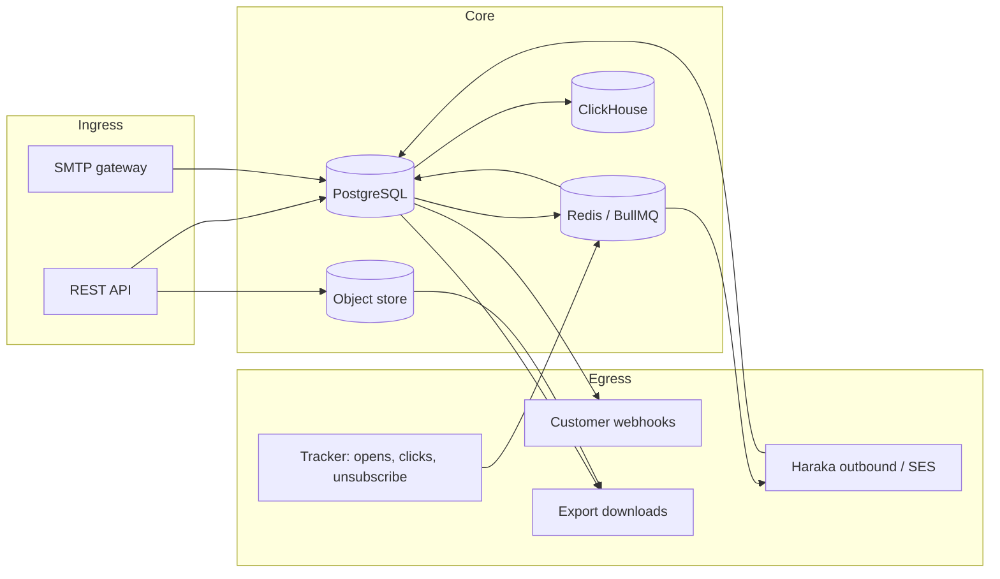

# Data inventory and flow map

**Control:** BASE-01 (compliance implementation plan)
**Reviewed:** 2026-07-25
**Review frequency:** quarterly, and on any change that adds a store, a
subprocessor, or a new data class.

This is the authoritative inventory of what personal and operational data the
platform holds, where it lives, and how it leaves. Every other privacy control
depends on it: an export that misses a store is incomplete, an erasure that
misses one is ineffective, and a retention policy that misses one is
unenforceable.

**Owner fields are unassigned in this repository.** The deploying organization
must fill in the named accountable roles from §2 of the compliance
implementation plan before this document becomes evidence.

## 1. Data classes

| Class | Examples | Sensitivity |
| --- | --- | --- |
| **Recipient data** | Recipient address, message subject and bodies, delivery/open/click events, tracked links, suppression and consent history, workflow journey state | Personal data; controller is the customer |
| **Account data** | User email, name, password hash, MFA factors, sessions, API keys, org membership, invites | Personal data; platform is controller |
| **Billing data** | Provider customer/subscription ids, invoices, credit notes, allowlisted webhook payloads | Commercial; no cardholder data (see `PAYMENT_DATA_FLOW.md`) |
| **Security and audit** | Audit log and hash chain, admin sessions and elevations, SCIM tokens, WebAuthn credentials | Security-sensitive |
| **Deliverability and operational** | Sending domains, DKIM keys, IP pools and reputation, DMARC reports, blocklist checks, quota and usage counters | Mostly non-personal; DMARC reports contain sending-domain evidence |
| **Support** | Tickets, ticket messages, internal notes | May contain personal data supplied by the customer |
| **Privacy operations** | Deletion requests, deletion object items, message tombstones, privacy cases and case events, legal holds, data exports | Evidence about personal data; identifiers pseudonymized (BASE-03) |

## 2. Stores

| Store | Contents | Retention | Erasure behaviour | Restore behaviour |
| --- | --- | --- | --- | --- |
| **PostgreSQL** (primary) | All tables listed in §3 | Per-table; see `RETENTION_AND_DISPOSAL.md` | Rows deleted or pseudonymized in a tenant transaction | Re-deletion required — `runbooks/RESTORE_RE_DELETION.md` |
| **Object store** (fs/S3) | Offloaded message bodies and attachments, export artifacts | Follows message body retention; exports `RETENTION_EXPORT_DAYS` | Deleted after dedup check; failures retried via `deletion_object_items` | Restored objects re-queued for deletion by tombstone replay |
| **Redis** | BullMQ queues (send, events, webhooks), rate-limit counters, suppression cache, auth lockouts | Ephemeral; queue payloads live until the job completes | Queued payloads purged; tombstones gate stale jobs | Rebuild rather than restore where possible |
| **ClickHouse** (optional) | Analytics copy of message events | `RETENTION_EVENT_DAYS`, plus a ClickHouse TTL that must be set to match | Deletion items recorded and retried; mutations are asynchronous | Re-queued by tombstone replay |
| **Application logs** | Operational telemetry | Deployment-defined | Not a system of record; redaction contract prevents PII (`LOG_REDACT_PATHS`) | N/A |
| **Metrics / tracing** (Prometheus, Grafana, Jaeger) | Counters, spans | Deployment-defined | No recipient identifiers by design — verify sampling config | N/A |
| **Backups** | PostgreSQL images, object-store versions | Deployment-defined | **Not selectively rewritten.** Erased data persists until the image expires | Re-deletion required on every restore |

## 3. PostgreSQL tables by class

Recipient data
: `messages` (+ partitions), `events` (+ partitions), `event_keys`,
  `tracked_links`, `send_outbox`, `suppressions`, `consent_events`,
  `unsubscribe_groups`, `unsubscribe_group_members`, `soft_bounce_tracker`,
  `consent_records`, `processing_restrictions`, `sale_share_optouts`,
  `recipient_domain_intel`, `workflows`, `workflow_versions`,
  `workflow_runs`, `workflow_run_steps`, `workflow_step_stats`,
  `unsubscribe_monitor_runs`

Account data
: `customers`, `users`, `memberships`, `user_sessions`, `user_tokens`,
  `user_invites`, `api_keys`, `mfa_factors`, `mfa_recovery_codes`,
  `webauthn_credentials`, `webauthn_challenges`, `scim_tokens`

Billing
: `subscriptions`, `invoices`, `invoice_line_items`, `credit_notes`,
  `billing_events`, `billing_plans`, `billing_plan_prices`,
  `billing_plan_change_requests`, `billing_dunning_state`,
  `billing_dunning_notifications`, `usage_daily`, `quota_notifications`

Security and audit
: `audit_log`, `audit_log_hashes`, `audit_log_archive`, `audit_checkpoints`,
  `admin_users`, `admin_sessions`, `admin_elevations`, `platform_settings`,
  `idempotency_keys`

Deliverability
: `sending_domains`, `dkim_keys`, `sending_ips`, `ip_pools`, `ip_reputation`,
  `dmarc_reports`, `dmarc_report_records`, `blocklist_checks`,
  `volume_baselines`, `templates`, `webhooks`, `webhook_delivery_log`,
  `clickhouse_sync_state`

Support
: `support_tickets`, `support_ticket_messages`, `support_ticket_reads`,
  `support_notes`, `support_canned_responses`, `review_queue`

Privacy operations
: `deletion_requests`, `deletion_object_items`,
  `privacy_message_tombstones`, `privacy_cases`, `privacy_case_events`,
  `legal_holds`, `regulatory_retention_locks`, `data_exports`

## 4. Flow map

### Egress points

| Destination | Data | Control |
| --- | --- | --- |
| Recipient mailbox | Message content, compliance footer | Suppression and classification checks before send |
| Customer webhook endpoint | Event metadata incl. recipient address | Signed, tenant-scoped, tombstone-gated |
| Export download | Message metadata, events | Tenant-scoped, expiring artifacts |
| Payment provider | Email, provider ids | Hosted checkout only |
| Analytics (ClickHouse) | Event rows | Same retention window as `events` |
| Subprocessors | Varies | **Register required — BASE-13, not yet populated** |

## 5. Known gaps

Carried from `COMPLIANCE_POSTURE.md` and the implementation plan; these are
inventory facts, not aspirations:

- **Data residency:** no application-level region assignment or region-pinned
  routing (GDPR-11).
- **Backups:** not selectively rewritten by erasure. Mitigated by
  restore-time re-deletion, not eliminated.
- **Subprocessor register:** not maintained in this repository (BASE-13).
- **Owners:** every row above needs a named accountable owner before this is
  audit evidence.

## Related

- `docs/RETENTION_AND_DISPOSAL.md` — BASE-06 retention schedule
- `docs/DATA_USE_RESTRICTIONS.md` — BASE-15 prohibited data classes
- `docs/COMPLIANCE_POSTURE.md` — control-by-control status
- `docs/runbooks/RESTORE_RE_DELETION.md` — post-restore obligations
