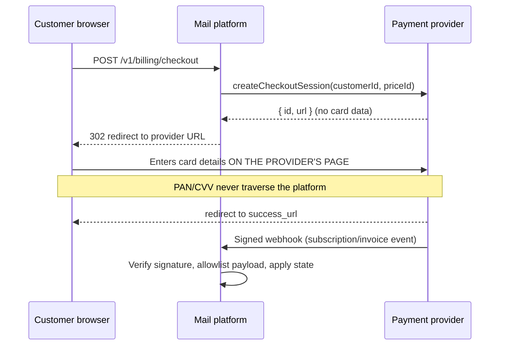

# Payment data flow and PCI DSS scope

**Control:** PCI-01 (compliance implementation plan)
**Reviewed:** 2026-07-25

This document records how payment data moves through the platform and the
evidence that primary account numbers (PAN) and sensitive authentication data
(SAD) do not enter platform systems.

It is an engineering scope assessment, not a PCI DSS validation. The
applicable SAQ, the final scope, and any Attestation of Compliance must be
confirmed by a QSA or qualified advisor (PCI-04 through PCI-06).

## Scope decision

The platform uses **provider-hosted checkout for every payment provider**. A
customer clicking "upgrade" is redirected to a URL created by Stripe, PayPal,
or Cashfree; card entry happens entirely on the provider's page, under the
provider's certificate and domain. The platform never renders a card form,
never proxies one, and never receives a card field.

Consequence: **no platform component stores, processes, or transmits
cardholder data**, and the systems here are not a cardholder data environment.

## Flow



Implementation: `createCheckoutSession` in
`packages/shared/src/billing-provider.ts` for each provider;
`packages/api/src/routes/billing.ts` for the webhook receiver.

## What the platform does store

| Data | Where | Why | Card data? |
| --- | --- | --- | --- |
| Provider customer id (e.g. `cus_…`) | `customers.stripe_customer_id` | Link a tenant to its provider record | No — an opaque provider reference |
| Provider subscription / price / item ids | `subscriptions` | Entitlements and metering | No |
| Invoice totals, currency, tax, period, hosted invoice URL | `invoices` | Billing history and reconciliation | No |
| Credit note totals, reason, memo | `credit_notes` | Refund history | No |
| Allowlisted webhook payload | `billing_events.payload` | Replay a mis-applied event | No — see below |

The platform stores **no** PAN, no truncated PAN, no cardholder name from the
card, no expiry, no service code, and no CVV/CVC/CID. It never receives them.

### Webhook payloads (PCI-03)

Provider events *do* carry payment-instrument fields — Stripe sends
`charges[]`, `payment_intent`, and `payment_method_details` (brand, last4,
expiry, billing address); Cashfree sends payer email and phone. Those are
dropped before storage by the allowlist in
`packages/shared/src/billing-payload-allowlist.ts`, which keeps only the
fields the replay parsers read. Stored payloads also expire
(`RETENTION_BILLING_PAYLOAD_DAYS`, default 90).

## Evidence queries

Run these against production to demonstrate absence. Each looks for a
Luhn-plausible card-length digit run. They are expected to return **zero
rows**; a non-zero result is a PCI-02 incident — see
`docs/runbooks/CARD_DATA.md`.

```sql
-- Billing webhook payloads
SELECT provider_event_id
FROM billing_events
WHERE payload::text ~ '[^0-9]([2-6][ -]?)([0-9][ -]?){11,17}[0-9][^0-9]';

-- Invoice and credit-note free text
SELECT id FROM credit_notes
WHERE COALESCE(memo,'') || COALESCE(reason,'')
      ~ '[^0-9]([2-6][ -]?)([0-9][ -]?){11,17}[0-9][^0-9]';

-- Support ticket content (redacted on write; this checks history)
SELECT id FROM support_ticket_messages
WHERE body ~ '[^0-9]([2-6][ -]?)([0-9][ -]?){11,17}[0-9][^0-9]';

-- Message content
SELECT message_id FROM messages
WHERE COALESCE(subject,'') || COALESCE(text_body,'') || COALESCE(html_body,'')
      ~ '[^0-9]([2-6][ -]?)([0-9][ -]?){11,17}[0-9][^0-9]';
```

The regex matches a 13-19 digit run, not adjacent to another digit, starting
with a card-brand leading digit (2-6). It is deliberately broader than the
application detector — it applies no Luhn or issued-length check — so it
over-reports rather than under-reports.

The brand-prefix constraint matters in practice: without it, every
millisecond epoch timestamp embedded in a provider event id (13 digits,
leading `1`) matches, and the query returns a hit for effectively every row.
Triage any hit with `detectCardBrand()` from
`packages/shared/src/card-data.ts` before treating it as an incident.

Also confirm no card data in logs and object storage:

- Application logs redact bodies, metadata, and payloads by default
  (`LOG_REDACT_PATHS` in `packages/shared/src/logging.ts`).
- Offloaded message bodies live in the object store; sample them with the same
  regex during the periodic review.

## Preventive controls

| Risk | Control |
| --- | --- |
| Customer emails a card number | Send and SMTP ingress reject on detection (PCI-02) |
| Customer pastes a card into support | Redacted on write (PCI-02) |
| Provider payload carries instrument data | Field allowlist (PCI-03) |
| Payload retained indefinitely | Retention sweep nulls the payload column |
| Card data reaches logs | Pino redaction contract |

## Responsibility split

| Area | Platform | Payment provider |
| --- | --- | --- |
| Card capture, storage, tokenization | — | Provider |
| Payment page and its scripts | — | Provider (hosted redirect) |
| Cardholder authentication / 3DS | — | Provider |
| Subscription state, entitlements, invoices metadata | Platform | — |
| Webhook signature verification and idempotency | Platform | — |
| Accidental card-data containment | Platform | — |

Because checkout is a **true hosted redirect**, the PCI DSS 4.0.1
payment-page script inventory and integrity-monitoring requirements (PCI-09)
apply to the provider's page, not to this platform. Document that
non-applicability with the assessor; it stops being true the moment an
embedded or iframed payment field is introduced, which would be a scope change
requiring reassessment.

## Open items

These remain and are tracked in the compliance implementation plan:

- **PCI-04** — formal CDE scope and segmentation statement, agreed with each
  provider.
- **PCI-05** — collect and annually monitor each provider's AOC.
- **PCI-06** — complete the applicable SAQ (expected SAQ A for a hosted
  redirect, subject to assessor confirmation).
- **PCI-08** — re-validate scope after any material billing or infrastructure
  change.

## Related

- `docs/runbooks/CARD_DATA.md` — accidental card-data incident response
- `docs/BILLING.md` — billing architecture
- `docs/COMPLIANCE_IMPLEMENTATION_PLAN.md` — PCI workstream
